# Progress report

Updated at every checkpoint review, about every 5M training steps. The newest report is at the
top. Earlier reports are kept below. The full methodology and every experiment are in
[EXPERIMENT_LOG.md](EXPERIMENT_LOG.md).

**Primary goal (Phase 1, stage 1: training ring).** The Go1 walks **naturally**: a steady
diagonal trot at about 0.6 m/s with no shin, knee or belly scraping and no falls. It **handles
walls**: it stops before hitting them and turns enough to keep walking. After that it moves on
to the obstacle course.

**Media.** Every review saves contact sheets of frames for all seeds, plus a walking video and
a head-on wall video (`.mp4` for presentations, `.gif` that plays here) for the best seed, in
`docs/media/review_<steps>M_<date>/`. Hand-made media for earlier stages is in `docs/media/`:
`world/`, `e6_ring_v1_sprinting/`, `report1/`, `report2/`.

### The training world

| Whole world: obstacle course (left) and training ring | Go1 robot dog |
|---|---|
|  | 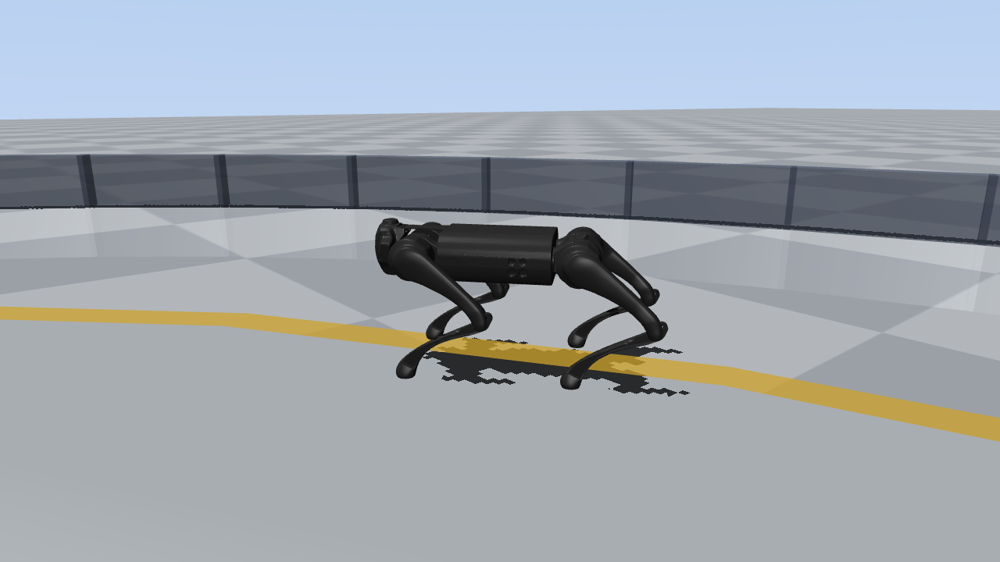 |

| Rubble and hurdles | Ramp and stairs | Slalom gates and goal |
|---|---|---|
| 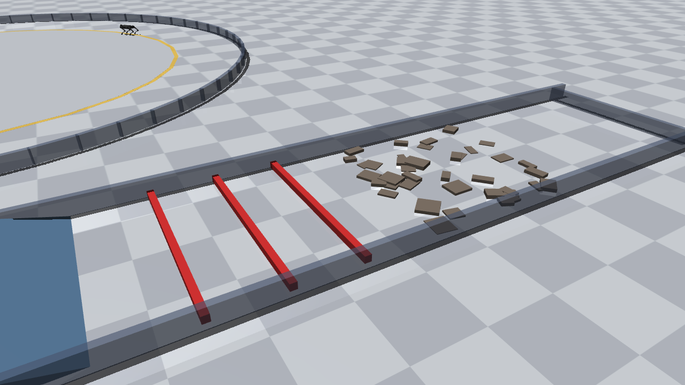 | 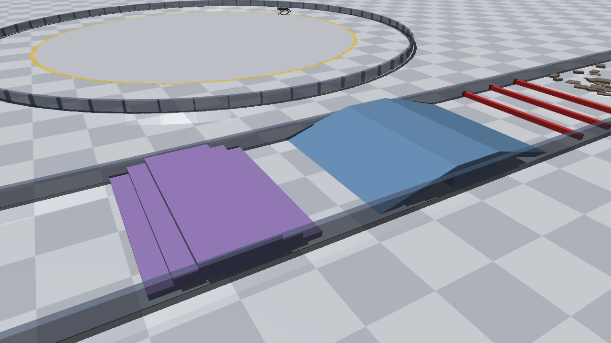 |  |

**How each checkpoint is judged** (`obstacle_course/evaluate_policy.py`, deterministic policy):

| Goal | Measure | Pass if |
|---|---|---|
| natural pace | \|speed − 0.6 m/s\| | ≤ 0.15 |
| trotting | trot match (feet follow the diagonal-trot clock) | ≥ 0.75 |
| trotting | mean feet on the ground | 1.6 – 2.6 |
| clean gait | steps with shins, knees or belly touching the ground | ≤ 5 % |
| stable | falls | ≤ 5 % |
| walls | wall test: start 1 m from the wall facing it (6 trials); pass = no prolonged contact and walks ≥ 1.5 m away | ≥ 80 % of trials |

**Decision rules for unattended tweaking:**
- **No restarts (2026-11-16, group decision).** Running jobs are never stopped or restarted
  from scratch. Reward or setting changes are applied after a run finishes, by **continuing
  training from its final policy** (`train.py --init-from`), so learned walking is kept.
- **Walls:** if wall pass rate is still < 50 % when the current runs finish (40M steps), continue
  from the best final policy with a "turn toward the route" reward (yaw rate toward the waypoint
  when it is > 45° off-heading) and turn-practice spawns raised from 25 % to 40 % (E8).
- **Shin contact:** if body contact is still > 5 % at the end of a run, raise the `collision`
  penalty in the continuation run, or check the calf collision geometry at the standing pose.
- **Pace or trot:** if they regress below goal for 2 seeds, raise the `trot` or
  `velocity_tracking` weight.
- **Falls:** if falls rise above 10 % after 10M steps, investigate before changing anything.
- **How changes are made:** one idea at a time. The old setting stays commented out in the
  code, failed runs are archived, and each change gets an entry in EXPERIMENT_LOG.md.

---

## Report 5: 2026-11-16, E7 finished (seeds 1 and 2) + first all-goals policy + E8 launched

### Milestone: first policy that meets every Phase 1 ring goal 🎉
**E7 seed 0 at 34M steps** passes all six goals. It is saved as

(policy + normalisation stats + metrics + videos).

| Pace | Trot | Feet down | Shin contact | Falls | Walls | Track error |
|---|---|---|---|---|---|---|
| ✅ 0.59 m/s | ✅ 0.99 | ✅ 2.0 | ✅ 0.6 % | ✅ 0 % | ✅ **83 %** (5/6) | 1.21 m (not a goal) |

Wall trials: head-on twice, +30°, −30° and +60° all passed. It turned away within about 1 s and
walked 4.1–6.1 m along the ring, never touching the wall (closest 0.64 m). It turns **both ways**
now. It failed only −60° (stuck, 0.35 m).

| Walking | Facing the wall head-on: turns away and walks off |
|---|---|
|  |  |

Videos: [walk.mp4](docs/media/review_34M_20261116_2128/ring_seed0/walk.mp4), [wall.mp4](docs/media/review_34M_20261116_2128/ring_seed0/wall.mp4).
Frames: 

Caveat: after turning, it walks alongside the outer wall instead of returning to the yellow
line (track error 1.2 m).

### E7 final results (40M steps)

| Run | Pace | Trot | Shin contact | Falls | Walls | Track error | Note |
|---|---|---|---|---|---|---|---|
| seed 0 | (still training, 34M → 40M) | | | | | | milestone above |
| seed 1 final | ✅ 0.59 | ✅ 1.00 | ✅ 0.1 % | ✅ 0 % | ❌ 17 % | 1.17 m | best walker, stuck at walls |
| seed 2 final | ✅ 0.48 | ✅ 0.92 | ❌ 10 % | ✅ 0 % | ❌ 17 % | 0.45 m | walking slipped late in training |

Media: , .

**What this tells us**
- The same reward gives very different wall behaviour per seed and per checkpoint. The skill
  appears and disappears (seed 0: 33 → 17 → 17 → 83 %; seed 1: 17 → 67 → 0 → 17 %).
  "Stop and wait at the wall" and "turn and go" earn similar reward in E7, so training drifts
  between them. A direct turning reward should make "turn and go" clearly better: that is E8.
- Long training can also erode walking (seed 2: shin contact 0.5 % → 10 % from 27M to 40M).
  Keeping milestone snapshots matters.

### What changed
- **E8 launched** (Amarel job 63982746, 3 seeds, 40M → 60M steps). It continues from **E7
  seed 1 final**, the best walker, which was stuck at walls and off the line:
  -  reward 1.0
  -  reward 1.0
  - wall/turn-practice spawns 25 % → 40 %
  - walking rewards unchanged
- Fixed  continuations keeping the 40M step count (it would have restarted the
  counter).

### Next
- Review E8 at each 5M milestone. Success: walls ≥ 80 % in both turn directions, track error
  ≤ 0.5 m, and the walking goals still passing.
- E7 seed 0 finishes 40M untouched.
- Once a policy meets all goals including track error, move to **stage 2: the obstacle
  course**, continuing from it.

---

## Report 4: 2026-11-16, ring v2 (E7) at 21–27M steps

**Status at a glance** (new column: track error = average distance from the yellow line)

| Run | Steps (eval ckpt) | Pace | Trot | Feet down | Shin contact | Falls | Walls | Track error | Overall |
|---|---|---|---|---|---|---|---|---|---|
| seed 0 | 20.9M (21M) | ✅ 0.59 m/s | ✅ 1.00 | ✅ 2.00 | ✅ 0.3 % | ✅ 0 % | ❌ 17 % | 1.14 m | walks perfectly, stuck at walls, off the line |
| seed 1 | 27.5M (27M) | ✅ 0.61 m/s | ✅ 0.99 | ✅ 2.00 | ✅ 0.2 % | ✅ 0 % | ❌ 0 % | 1.00 m | walks perfectly, stuck at walls, off the line |
| seed 2 | 27.7M (27M) | ✅ 0.60 m/s | ✅ 0.99 | ✅ 2.02 | ✅ 0.5 % | ✅ 0 % | ❌ 17 % | 0.23 m | walks perfectly on the line, stuck at walls |

**Media** (seed 0, 21M; video: [walk.mp4](docs/media/review_20M_20261116_2054/ring_seed0/walk.mp4), [wall.mp4](docs/media/review_20M_20261116_2054/ring_seed0/wall.mp4))

| Walking | Facing the wall head-on: stops about 1 m short and trots in place |
|---|---|
|  |  |

**What changed since report 3**
- No training changes (no restarts).
- E8 extended (still opt-in, off for running jobs): added a `track_following` reward after the
  group noticed later policies walking off the yellow line. Measured: seeds 0 and 1 walk
  1.0–1.4 m *outside* the line, seed 2 stays within 0.2–0.4 m.

**What's working**
- **Walking is perfect and stable on all 3 seeds:** trot match 0.99–1.00, exactly 2 feet down,
  0.59–0.61 m/s, shin contact ≤ 0.5 %, no falls.
- **No wall collisions** in the head-on, ±30° and −60° trials. The dog always stops about 1 m
  short.

**What's not working (poor progress, so tweaking)**
- **Wall turning is getting worse with training:** 33/17/67 % (report 2) → 17/67/17 %
  (report 3) → **17/0/17 %** now. The only pass left is the +60° glancing angle.
  - The policies have converged on "stop at the wall and trot in place". In E7 that is a safe
    local optimum: it keeps the alive, trot and heading rewards and avoids the wall penalties.
    Turning around has no direct payoff.
  - Seen in the viewer for seed 0 (10M): at +60° it scrapes along the wall (6–9 touches) instead
    of turning away.
- **Track drift** on seeds 0 and 1 (about 1 m outside the line). Nothing rewards being on the line.

**Next: E8 (automatic, as soon as seeds 1 and 2 finish 40M, about 25 min)**
- Continue from the best E7 final policy with no restart:
  - `turn_to_route` reward 1.0
  - `track_following` reward 1.0
  - turn-practice spawns 40 %
- Success: wall pass rate ≥ 80 % and track error ≤ 0.5 m, with all walking goals still passing.

---

## Report 3: 2026-11-16, ring v2 (E7) at 16–21M steps

**Status at a glance**

| Run | Steps (eval ckpt) | Pace | Trot | Feet down | Shin contact | Falls | Walls | Overall |
|---|---|---|---|---|---|---|---|---|
| seed 0 | 16.0M (16M) | ✅ 0.59 m/s | ✅ 0.99 | ✅ 1.98 | ✅ 0.2 % | ✅ 0 % | ❌ 17 % | 5 of 6 goals |
| seed 1 | 21.1M (21M) | ✅ 0.60 m/s | ✅ 1.00 | ✅ 2.00 | ✅ 0.4 % | ✅ 0 % | 🟡 67 % | 5 of 6 goals, best at walls |
| seed 2 | 21.2M (21M) | ✅ 0.58 m/s | ✅ 0.99 | ✅ 2.02 | ✅ 0.4 % | ✅ 0 % | ❌ 17 % | 5 of 6 goals |

**Media** (best seed: seed 1, 21M steps; video: [walk.mp4](docs/media/review_15M_20261116_2042/ring_seed1/walk.mp4),
[wall.mp4](docs/media/review_15M_20261116_2042/ring_seed1/wall.mp4))

| Walking (trot match 1.00) | Facing the wall head-on: turns away and walks off |
|---|---|
|  |  |

- seed 1 at the wall (turns): 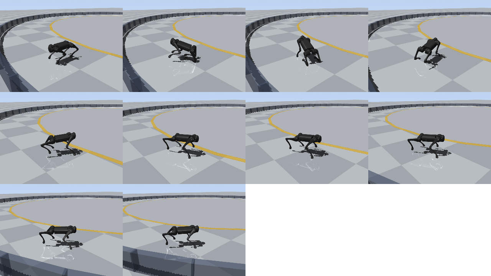
- seed 2 at the wall (now stuck; it was turning at 14M): 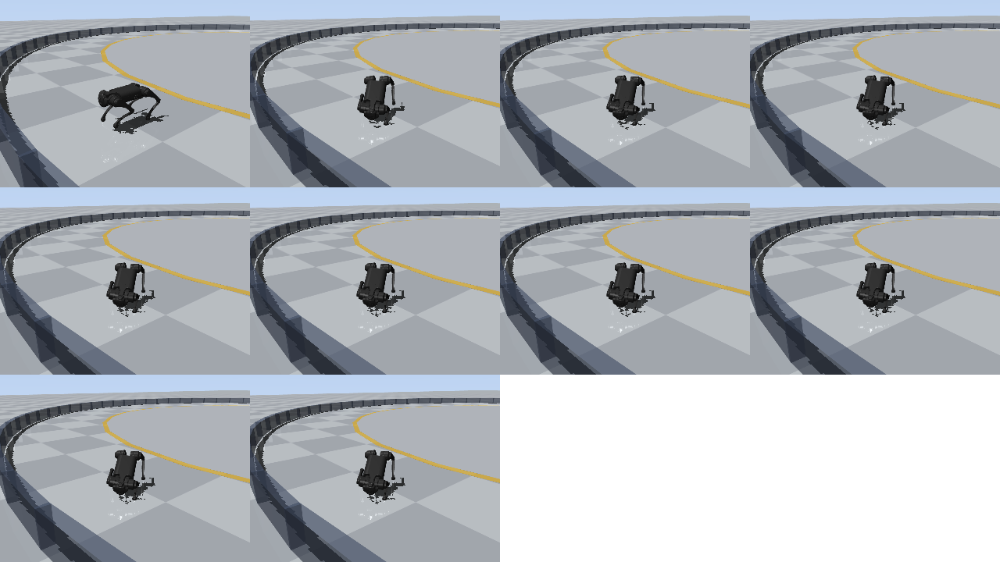

**What changed since report 2**
- No training changes (no restarts).
- Tooling:
  - `play.py --wall-test` replays the wall test in the MuJoCo viewer.
  - Reviews now save media automatically.
- **Prepared, not yet used:** E8. An opt-in `turn_to_route` reward plus a
  `--turn-practice` spawn share (see EXPERIMENT_LOG). It is off by default, so the running jobs are unaffected.

**What's working**
- **Walking is essentially perfect on all 3 seeds:**
  - trot match 0.99–1.00, exactly about 2 feet down (a clean diagonal pair)
  - pace within 0.02 m/s of target, shin contact < 0.5 %, no falls
- **Never touching walls.** In all 18 trials the dog stopped before the wall.

**What's not working**
- **Turning away from walls is unstable.** The pass rate swaps between seeds from one
  checkpoint to the next:

  | Seed | 10–14M | 16–21M |
  |---|---|---|
  | 0 | 33 % | 17 % |
  | 1 | 17 % | 67 % |
  | 2 | 67 % | 17 % |

  Each policy learns to turn one way, then drifts. More training alone is not settling it: turning
  is paid only indirectly (heading +0.5), and only about 25 % of episodes practise it.
- Seeds 0 and 1 drift about 1 m off the track line while still walking well (track error
  1.1–1.2 m vs 0.3 m for seed 2). This is minor and not a goal yet.

**Next**
- E7 finishes at 40M steps (seeds 1 and 2 in about 25 min; seed 0 is on a slower node).
- Then, per the decision rules (wall pass rate < 50 % for most seeds), run **E8 as a
  continuation** from the best E7 final policy:
  - `turn_to_route` = 1.0 (reward for turning toward the route when facing more than 45° away)
  - turn-practice spawns 25 % → 40 %
  - walking rewards unchanged

---

## Report 2: 2026-11-16, ring v2 (E7) at 10–14M steps

**Status at a glance**

| Run | Steps (eval ckpt) | Pace | Trot | Feet down | Shin contact | Falls | Walls | Overall |
|---|---|---|---|---|---|---|---|---|
| seed 0 | 10.7M (10M) | ✅ 0.60 m/s | ✅ 0.97 | ✅ 1.88 | ✅ 0.3 % | ✅ 0 % | ❌ 33 % | 5 of 6 goals |
| seed 1 | 14.1M (14M) | ✅ 0.62 m/s | ✅ 0.97 | ✅ 1.88 | ✅ 0.3 % | ✅ 0 % | ❌ 17 % | 5 of 6 goals |
| seed 2 | 14.3M (14M) | ✅ 0.60 m/s | ✅ 0.98 | ✅ 1.92 | ✅ 0.2 % | ✅ 0 % | 🟡 67 % | 5 of 6 goals, walls close |

**Media** (best seed: seed 2, 14M steps; full-quality video:
[walk.mp4](docs/media/report2/seed2/walk.mp4), [wall.mp4](docs/media/report2/seed2/wall.mp4))

| Walking: natural trot at 0.6 m/s | Facing the wall head-on: stops, turns, walks away |
|---|---|
| 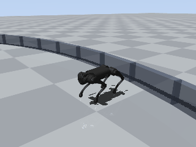 |  |

Frame sequences (left to right, top to bottom):
- seed 2 walking: 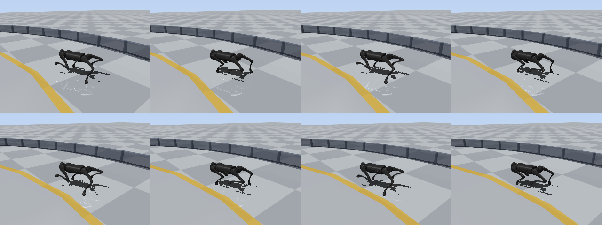
- seed 2 at the wall (turns around): 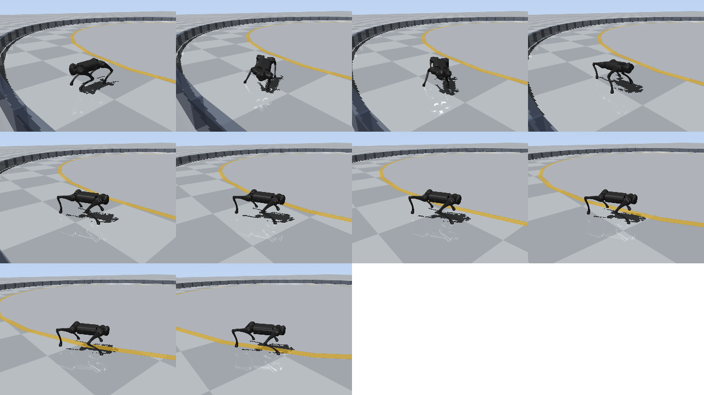
- seed 0 at the wall (stops but stays stuck): 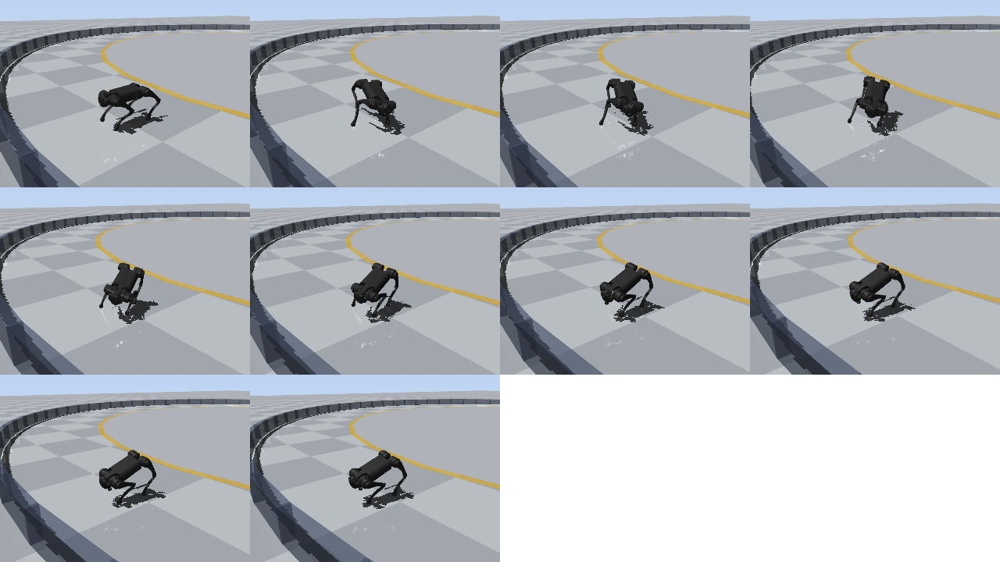

**For comparison, the failed sprinting policy (E6, ring v1 at 7M steps):** it bounds at
2.7 m/s with about 1.3 feet down and shins scraping. Video:
[walk.mp4](docs/media/e6_ring_v1_sprinting/walk.mp4)

**What changed since report 1**
- No reward or setting changes. Training simply continued (no restarts, per the group decision).
- Tooling:
  - `play.py` now plays policies at real time in a loop, for watching the gait.
  - Checkpoint reviews now trigger when the slowest run passes a milestone.
- Hardware decided: keep 32-core CPU nodes. 64 cores gave the same speed (EXPERIMENT_LOG H1).

**What's working**
- **Natural walking is solved for all 3 seeds:**
  - pace within 0.02 m/s of the 0.6 m/s target
  - trot match 0.97–0.98, about 1.9 feet down (a clean diagonal pair)
  - shin contact down from 11–12 % to 0.2–0.3 %
  - 9–11 cm foot lift and no falls
- **Walls: "stop before the wall" is solved.** Across all 18 wall trials the dog never touched
  the wall once. It always stops about 1 m short.
- **Walls: "turn and keep going" is emerging on its own.** Seed 2 turns around from a head-on
  start and trots away along the track in 4 of 6 trials (`progress/ppo_ring_seed2/eval/frames_wall.png`):
  it faces the wall, turns in place for about 2 s, then walks off.

**What's not working yet**
- **Turning is still unreliable.** Seeds 0 and 1 often stand and trot in place when facing the
  wall (33 % and 17 %). Each seed tends to turn only one way: seed 1 passed only the −60° trial,
  and seed 0 only +30° and +60°. When the "easy" turn direction is the wrong one, it gets stuck.

**Next**
- Training continues to 40M steps (about 25 more minutes). Walls are improving without changes,
  so no tweak yet.
- At 40M, by the decision rules: if wall pass rate is < 50 % for the best seed, continue from
  that policy with the "turn toward the route" reward (E8).
- If the walls pass (seed 2 is close), next comes stage 2: the obstacle course, continuing from
  the best ring policy.

---

## Report 1: 2026-11-16, ring v2 (E7) at about 5M steps

**Status at a glance**

| Run | Steps | Pace | Trot | Feet down | Shin contact | Falls | Walls | Overall |
|---|---|---|---|---|---|---|---|---|
| seed 0 | 3.7M (eval of the 3M ckpt) | ❌ 0.12 m/s | ✅ 0.79 | ❌ 2.75 | ✅ 2 % | ✅ 0 % | ❌ 0 % | still learning to move |
| seed 1 | 5.3M | ✅ 0.55 m/s | ✅ 0.84 | ✅ 2.28 | ❌ 12 % | ✅ 0 % | ❌ 0 % | 4 of 6 goals |
| seed 2 | 5.2M | ✅ 0.51 m/s | ✅ 0.87 | ✅ 2.09 | ❌ 11 % | ✅ 0 % | ❌ 17 % | 4 of 6 goals |

**Media** (frames at 5M steps; no videos were recorded yet at this stage)

| Seed 2 walking | Seed 2 facing a wall: stops, then trots in place |
|---|---|
| 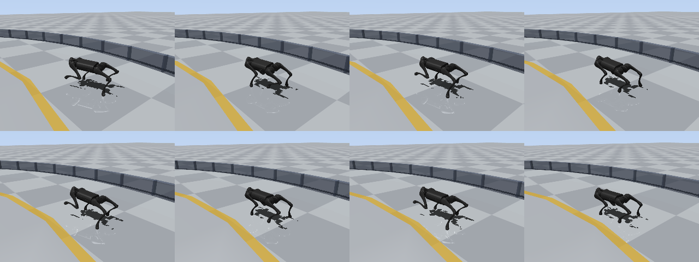 | 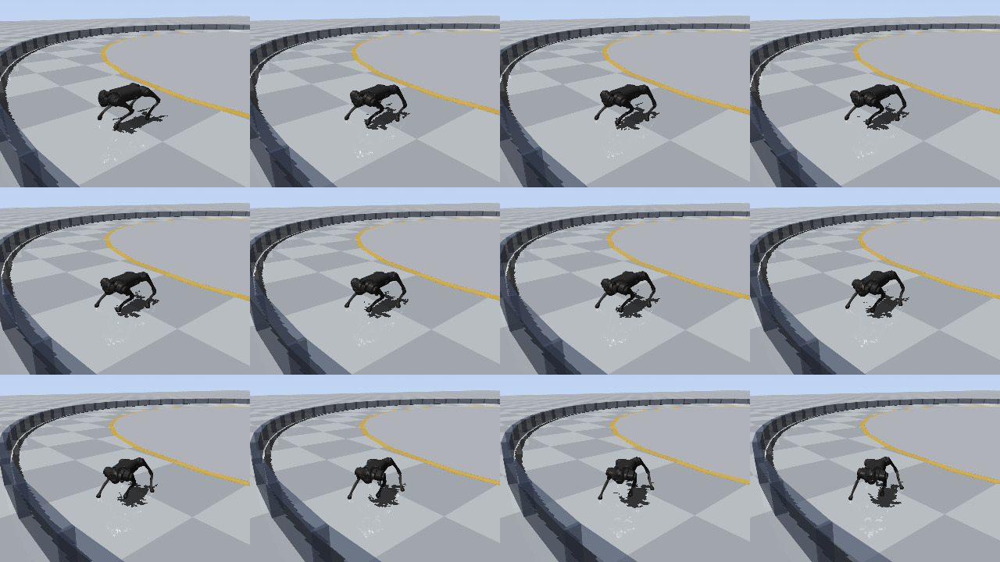 |

**What changed since the last run**
- Fixed the sprinting reward hack from ring v1 (E6):
  - progress is capped at the target speed
  - the lap bonus is removed
  - speed tracking is stronger, trot ×2, shin-contact penalty ×2
- Added the goal-based checkpoint evaluation (`evaluate_policy.py`) and the review tool
  (`tools/review_checkpoint.py`).

**What's working**
- **The gait fix worked.** v1 bounded at about 3 m/s with a trot match of 0.52. v2 seeds 1 and 2
  now trot at the target pace (0.51–0.55 m/s) with a trot match of 0.84–0.87, about 2 feet down,
  9–11 cm foot lift and no falls, after only about 5M steps (about 10 minutes).
- The frames show a level body with diagonal legs alternating.

**What's not working yet**
- **Walls (main gap).** Facing a wall from 1 m, the dog stops short without touching it, which
  is good, but then trots in place instead of turning. It only gets away when the wall is at a
  shallow angle (60°).
- **Shin contact 11–12 %.** Seeds 1 and 2 occasionally brush a calf on the ground.
- **Seed 0** is behind: it stands and trots in place (0.12 m/s). It may catch up; seeds vary.

**Next**
- Let E7 run to 40M steps (no restart), then apply the decision rules above (walls first).
- **Hardware:** benchmarked 32 vs 64 CPU cores: same speed (about 8,900 steps/s), because the
  network update is the bottleneck. Decision: keep 32-core CPU nodes (EXPERIMENT_LOG H1).
