# Progress report

Updated at every checkpoint review, about every 5M training steps. The newest report is at the
top. Earlier reports are kept below. The full methodology and every experiment are in
[EXPERIMENT_LOG.md](EXPERIMENT_LOG.md).

**Primary goal (Phase 1, stage 1: training ring).** The Go1 walks **naturally**: a steady
diagonal trot at about 0.6 m/s with no shin, knee or belly scraping and no falls. It **handles
walls**: it stops before hitting them and turns enough to keep walking. After that it moves on
to the obstacle course.

**Media.** Every review saves contact sheets of frames for all seeds, plus a walking video and
a head-on wall video (`.mp4` for presentations, `.gif` that plays here) for the best seed, in
`docs/media/review_<steps>M_<date>/`. Hand-made media for earlier stages is in `docs/media/`:
`world/`, `e6_ring_v1_sprinting/`, `report1/`, `report2/`.

### The training world

| Whole world: obstacle course (left) and training ring | Go1 robot dog |
|---|---|
| 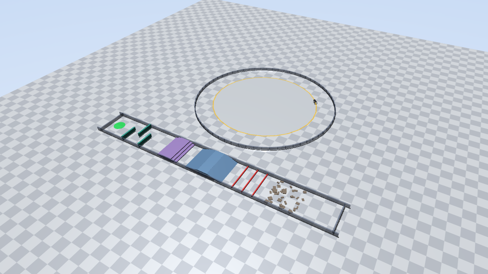 |  |

| Rubble and hurdles | Ramp and stairs | Slalom gates and goal |
|---|---|---|
|  |  | 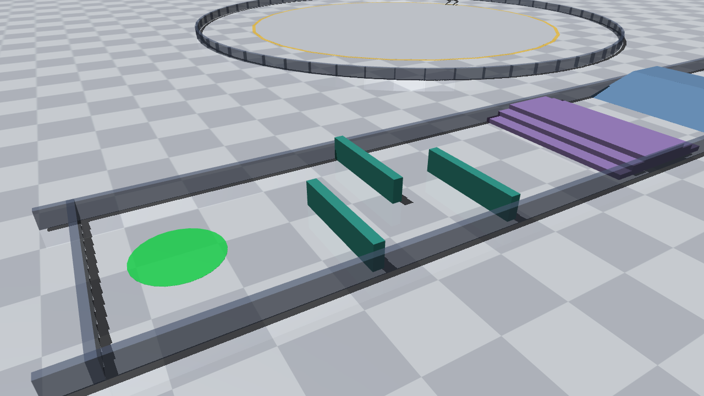 |

**How each checkpoint is judged** (`obstacle_course/evaluate_policy.py`, deterministic policy):

| Goal | Measure | Pass if |
|---|---|---|
| natural pace | \|speed − 0.6 m/s\| | ≤ 0.15 |
| trotting | trot match (feet follow the diagonal-trot clock) | ≥ 0.75 |
| trotting | mean feet on the ground | 1.6 – 2.6 |
| clean gait | steps with shins, knees or belly touching the ground | ≤ 5 % |
| stable | falls | ≤ 5 % |
| walls | wall test: start 1 m from the wall facing it (6 trials); pass = no prolonged contact and walks ≥ 1.5 m away | ≥ 80 % of trials |

**Standing requirement: a natural look for a professional demo (added 2026-11-16).** Passing the
gait numbers is not enough. The dog must *look* natural: body pointing where it walks, level,
not leaning or crabbing. Every review now also measures:

| Goal | Measure | Pass if |
|---|---|---|
| no crabbing | crab angle (body heading vs direction of travel) | ≤ 10° |
| level body | roll (sideways lean) | ≤ 3° |
| level body | pitch (nose up/down) | ≤ 4° |

**Leg posture and step uniformity goals (added 2026-11-16):**

| Goal | Measure | Pass if |
|---|---|---|
| legs straight under the body | mean sideways stance-foot offset vs the standing pose | ≤ 5 cm |
| legs not trailing or reaching | mean fore-aft stance-foot offset vs the standing pose | ≤ 8 cm |
| uniform steps | (max − min) / mean of the four legs' step heights | ≤ 20 % |

**Stage 2 goal (obstacle course):** start at the beginning of the course and reach the goal pad
(goal rate ≥ 67 % over 3 runs), first at the curriculum difficulty, then at full difficulty
(1.0), while keeping the natural-gait goals.

**Decision rules for unattended tweaking:**
- **No restarts (2026-11-16, group decision).** Running jobs are never stopped or restarted
  from scratch. Reward or setting changes are applied after a run finishes, by **continuing
  training from its final policy** (`train.py --init-from`), so learned walking is kept.
- **Walls:** if wall pass rate is still < 50 % when the current runs finish (40M steps), continue
  from the best final policy with a "turn toward the route" reward (yaw rate toward the waypoint
  when it is > 45° off-heading) and turn-practice spawns raised from 25 % to 40 % (E8).
- **Shin contact:** if body contact is still > 5 % at the end of a run, raise the `collision`
  penalty in the continuation run, or check the calf collision geometry at the standing pose.
- **Pace or trot:** if they regress below goal for 2 seeds, raise the `trot` or
  `velocity_tracking` weight.
- **Falls:** if falls rise above 10 % after 10M steps, investigate before changing anything.
- **How changes are made:** one idea at a time. The old setting stays commented out in the
  code, failed runs are archived, and each change gets an entry in EXPERIMENT_LOG.md.

---

## Report 43: 2026-11-17, C13 at 240–246M: dropped back to 2/6; the stairs block 13 of 18 runs

Benchmark 0.5, 6 layouts:

| Run | Goals | Where the failures stopped |
|---|---|---|
| C13 seed 0 (245M) | 2 / 6 (39.4, 40.4 s) | stairs ×4 |
| C13 seed 1 (246M) | 1 / 6 (47.3 s) | stairs ×4, rubble ×1 |
| C13 seed 2 (240M) | 1 / 6 (56.6 s) | stairs ×4, rubble ×1 |

- **Not working:** seed 0 fell from 4/6 at 237M to 2/6. This is the peak-then-drop pattern
  seen in C8–C11, so the final policy will again be picked by a checkpoint sweep, not by the
  newest checkpoint.
- **The stairs:** they are the single bottleneck.
  - Every stairs failure stops at x ≈ 15.15 m: the body is about 0.55 m in, front feet on the
    first or second step.
  - Hurdles and the ramp clear on every run that reaches them.
- **Training (curriculum):** stairs difficulty is 0.65–0.7, but the stairs clear rate is only
  0.26–0.31. Elsewhere: ramp 0.85–0.9, other sections 1.0. Falls 20 %, trot_match 0.82–0.83.
- **Posture on the course is fine:** crab 0.3–8°, roll ≤ 3.3°, pitch ≤ 1.5°, feet under the
  hips (splay < 4 cm).

Media: [`docs/media/review_240M_20261117_1111/`](docs/media/review_240M_20261117_1111). Best-seed video:

**Decision:** no reward change yet. The terrain-aware lift has had only about 13M steps, and
the stairs already get 3× spawn weight. At about 260M, sweep every C13 checkpoint on Amarel at
0.5 and 0.75. If the stairs clear rate is still flat, the next step is a stairs-specific fix:
spawn practice directly on the first step, and/or a body-height reward relative to the terrain.

---

## Report 42: 2026-11-17, C13 (terrain-aware foot lift): 4 of 6 at a regular review

Benchmark 0.5, 6 layouts:

| Run | Goals | Goal times |
|---|---|---|
| **C13 seed 0 (237M)** | **4 / 6** ✅ | 31.9, 46.9, 47.7, 51.3 s |
| C13 seed 1 (237M) | 2 / 6 | 35.9, 39.3 s |
| C13 seed 2 (235M) | 0 / 6 | stairs ×4, rubble ×2 |
| C12 seed 2 (239M) | 3 / 6 | 31.4, 40.2, 44.4 s |
| C12 seed 1 (236M) | 1 / 6 | 46.9 s |
| C12 seed 0 (233M) | 0 / 6 | ramp crest ×5 |

- **Working:** about 4M steps after the terrain-aware lift, C13 seed 0 meets the stage-2 target
  (≥ 4/6) at a regular 5M review. Before, that only showed up in sweeps.
- **Not working:** the stairs still stop some runs (C13 seed 2: 4 of 6).

Milestone [`progress/milestones/c13_seed0_237M_bench05_4of6/`](progress/milestones/c13_seed0_237M_bench05_4of6) (benchmark video: layout 0, goal in 31.9 s):

**Next:** let C13 train further, then **sweep its checkpoints at 0.5, 0.75 and 1.0**. The real test of
the terrain-aware lift is whether the full-height stairs (0.75 and 1.0) start to clear.

---

## Report 41: 2026-11-17, C12 holds the stage-2 skill; the stairs are the last wall → C13 (terrain-aware foot lift)

### C12 (learning rate 1e-4), benchmark 0.5, 6 layouts

| Review | seed 0 | seed 1 | seed 2 | Total |
|---|---|---|---|---|
| 220–222M | 0/6 | 2/6 (32.7, 48.5 s) | **3/6** (31.6, 32.5, 50.7 s) | 5/18 |
| 225–228M | 0/6 | 2/6 (45.3, 46.4 s) | 2/6 (31.9, 42.3 s) | 4/18 |

- **Working:** the lower learning rate keeps the skill without the collapse seen in C11 (so far).
- **Not working:** **11 of the 14 failed runs stop at the stairs (x ≈ 15.1 m).**

### Why the stairs still block: the step-shape reward fought the stumble penalty
`swing_shape` (from E11/E12) pulls every swinging foot to an **8 cm lift, measured above the ground
directly under that foot**. On stairs, a rear foot still over the lower step is "8 cm up" relative to
*that* step. That is barely enough for a 6 cm riser (benchmark) and not enough for 9 cm (full).

Measured on the stage-2 policy climbing the full-height stairs (348 swing-foot samples within 10 cm
before a riser):

| Lift measured against | Mean | Share below 3 cm |
|---|---|---|
| ground under the foot (old) | **11.5 cm**: the reward thinks it's fine | 9 % |
| **the next step** (new) | **2.5 cm**: about to stub the riser | **48 %** |

### Change: C13 (Amarel job 63991604, 3 seeds, from C12 seed 2 at 232M → 292M)
- **`--terrain-aware-swing`**: a swinging foot's lift is measured against the **higher of the ground
  under it and 12 cm ahead**, so the target means "8 cm above the next step". On flat ground nothing
  changes.
- Learning rate 1e-4 kept. Curriculum continues from C12 seed 2 (ramp 0.95, stairs 0.75).
- Everything else as C12.

---

## Report 40: 2026-11-17, 🏆 STAGE 2 BENCHMARK MET: the healthy Go1 crosses the course in 75 % of runs

### Checkpoint sweep: all 65 C11 checkpoints (199–225M), benchmark 0.5, 6 layouts

| Goals out of 6 | Checkpoints |
|---|---|
| **5** | **2** |
| **4** | **15** |
| 3 | 11 |
| 2 | 9 |
| 1 | 8 |
| 0 | 20 |

Goals per checkpoint along training (each seed):
- seed 0: 1, 3, 2, **4**, 3, 4, 4, 4, **5**, 4, 3, 4, 3, 4, 1, then **0 from 214M on**
- seed 1: 2, 3, 2, 3, 2, 2, 4, 2, 4, 3, 1, 1, 2, then **0 from 212M on**
- seed 2: 2, 1, 1, **4**, 3, 3, 4, **5**, 4, 3, 4, 1, 4, 2, 3, 4

**All seeds peaked at about 202–214M, then two of them collapsed**, as the curriculum pushed the ramp
and stairs to their hardest levels. The single 5M-step reviews (0–3 of 6) had hidden how good the
peak was. Choosing by sweep matters.

### Validation of the top 4 on 12 rubble layouts, at three difficulties

| Checkpoint | 0.5 (benchmark) | 0.75 | 1.0 (full) |
|---|---|---|---|
| **C11 seed 2 at 214M** | **9 / 12 (75 %)** | 1 / 12 | 0 / 12 |
| C11 seed 0 at 207M | 8 / 12 (67 %) | 2 / 12 | 0 / 12 |
| C11 seed 2 at 206M | 6 / 12 | 1 / 12 | 0 / 12 |
| C11 seed 0 at 202M | 6 / 12 | 1 / 12 | 0 / 12 |

### ✅ Stage 2 milestone policy: [`progress/milestones/STAGE2_c11_seed2_214M_bench05_9of12/`](progress/milestones/STAGE2_c11_seed2_214M_bench05_9of12)
**C11 seed 2 at 214M crosses the full course from the start to the goal in 75 % of runs** with all
obstacles at half size (12 layouts; times 36–56 s). The fastest recorded run took **31.1 s**:

Video: [course_goal.mp4](progress/milestones/STAGE2_c11_seed2_214M_bench05_9of12/course_goal.mp4). The run frame by frame:
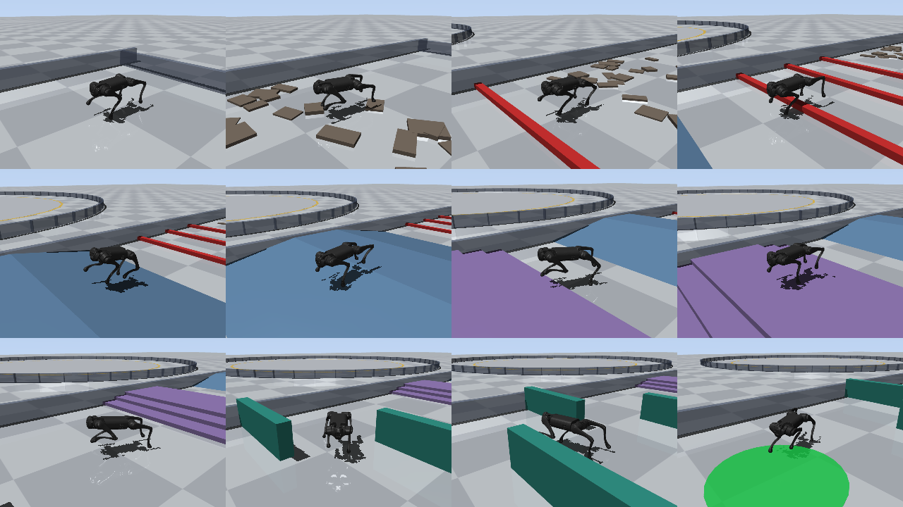

### Not yet: full difficulty
At 0.75, 1–2 of 12; at 1.0 (full-size obstacles), 0 of 12. Runs stop at the **full-height stairs**
(15.1 m, 9 cm steps) or the **full 15° ramp** (11.0 m).

### Change: C12 (Amarel job 63990557, 3 seeds, from the stage-2 milestone at 214M → 274M)
- **Learning rate 3e-4 → 1e-4**, to stop the post-peak collapse seen in C11.
- The curriculum continues from the milestone's levels (ramp 1.0, stairs 0.75, others 1.0).
- Everything else as C11 (stumble penalty, weighted stairs/rubble practice, per-section curriculum,
  real friction, terrain-relative tilt).
- Goal: raise the 0.75 and 1.0 results without losing the 0.5 result. C12 will be judged by a
  checkpoint sweep at 0.5, 0.75 and 1.0.

Data: `progress/sweeps/sweep_c11_199-225M.json`, `progress/sweeps/validate_c11_top4.json`.

---

## Report 39: 2026-11-17, 🏁 new best: 3 of 6 benchmark crossings (C11 seed 0)

Benchmark: all obstacles 0.5, 6 rubble layouts.

| Run | Goals | Goal times | Where non-goal runs stop |
|---|---|---|---|
| **C11 seed 0 (212M)** | **3 / 6** | **43.3, 46.7, 54.3 s** | stairs ×2, slalom ×1 |
| C11 seed 1 (210M) | 1 / 6 | 41.2 s | stairs ×3 (1 fall), rubble ×2 |
| C11 seed 2 (206M) | 1 / 6 | 34.7 s | stairs ×3 (1 fall), hurdles, rubble |

- **C11 overall: 5 goals in 18 runs.** The first policy at 50 % (target ≥ 4/6).
- The slalom no longer dominates (1 stop). The remaining stops are mostly the **stairs** (8),
  then rubble (3).
- Training: falls back down to 16–33 %. Ramp level 0.75–1.0, stairs 0.55–0.75.
- Body straight on the course for seeds 0 and 2 (crab 2.9° and 0.6°); seed 1 crab 14° ❌.

Milestone [`progress/milestones/c11_seed0_212M_bench05_3of6/`](progress/milestones/c11_seed0_212M_bench05_3of6) with its benchmark video (layout 0, goal in 43.3 s):

Video: [course.mp4](progress/milestones/c11_seed0_212M_bench05_3of6/course.mp4)

**Decision:** no change. C11 is improving review on review (2/6 → 3/6 best; 2/18 → 5/18 overall),
so the slalom tweak (C12) is not needed for now. C11 runs to 258M. Then a **checkpoint sweep**
picks the final stage-2 policy, followed by the full-difficulty test (1.0).

---

## Report 38: 2026-11-17, ✅ stumble penalty works: ramp and stairs levels jump; the slalom is the next bottleneck

### Training (C11 at 203–207M, 2–4M steps after adding `feet_stumble`)

| | ramp level | stairs level | stairs clear rate | goal rate | falls |
|---|---|---|---|---|---|
| C10 (before) | 0.30–0.65 | 0.30–0.55 | 24–33 % | 11–17 % | 16–30 % |
| **C11** | **0.70–0.95** | **0.60–0.75** | **51–58 %** | **30–33 %** | 38–46 % |

### Benchmark (all obstacles 0.5, 6 layouts)

| Run | Goals | Where non-goal runs stop |
|---|---|---|
| **C11 seed 2 (200M)** | **2 / 6 (32.8 s, 50.1 s)** | **slalom ×3** (19.4–20.2 m), hurdles ×1 |
| C11 seed 0 (202M) | 0 / 6 | **slalom ×2** (20.6 m), stairs ×2, rubble, hurdles |
| C11 seed 1 (201M) | 0 / 6 | stairs ×3, slalom ×1, rubble ×2 |
| C10 seeds 0–2 (210–224M) | 0 / 18 | ramp crest, stairs, rubble |

- **Working: the stumble penalty fixed the riser problem.** C11 runs get past the stairs to the
  slalom in 6 of 18 benchmark runs, and both the ramp and stairs levels jumped.
- **Not working:**
  - **The slalom is now the main stopping point** for the best runs.
  - Falls in training rose to 38–46 % (watch).

Milestone [`progress/milestones/c11_seed2_200M_bench05_2of6/`](progress/milestones/c11_seed2_200M_bench05_2of6). A full crossing in 32.8 s (layout 3):

And a run that stops in the slalom (layout 0, 20.2 m):
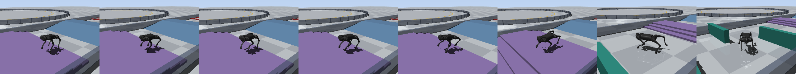
Videos: [course_goal.mp4](progress/milestones/c11_seed2_200M_bench05_2of6/course_goal.mp4) · [course_slalom_stop.mp4](progress/milestones/c11_seed2_200M_bench05_2of6/course_slalom_stop.mp4)

### Likely cause of the slalom stops
The slalom barriers are "walls" to the dog's range sensors. In stage 1 it learned to **stop before
walls and turn away** (`wall_contact`, `wall_proximity` within 0.4 m). Weaving needs it to pass close
to a barrier end. The last frame above shows it stopped between gates, turned sideways near a
barrier.

**Decision:** one more review first. C11 is only 2–4M steps old, and the slalom now gets far more
practice because the dog actually reaches it. If the slalom still blocks, the candidate fix (C12)
is more slalom practice (`section_weights` slalom 2) and a smaller wall-proximity zone on the
course (0.4 → 0.2 m).

---

## Report 37: 2026-11-17, checkpoint sweep: C10 tops out at 2 of 6; the stairs riser is the bottleneck → C11 (stumble penalty)

### Reliability swings between checkpoints
The 5M-step review of C10 (205–214M) got **0 of 18**, a few million steps after 3 of 18. To stop
judging by whichever checkpoint a review lands on, I added a **checkpoint sweep**
(`tools/checkpoint_sweep.py` + `amarel/sweep.slurm`). It evaluates every saved checkpoint on the
fixed benchmark (all obstacles 0.5, 6 rubble layouts), in parallel on a 32-core Amarel node.

**C10 sweep: 54 checkpoints (196–218M, 3 seeds).** Results: `progress/sweeps/sweep_c10_196-218M.json`

| Goals out of 6 | Checkpoints |
|---|---|
| 2 / 6 | 6 (best: C10 seed 0 at 198M, mean 18.5 m, goals in 34.7 s and 49.7 s) |
| 1 / 6 | 7 |
| 0 / 6 | 41 |

- Goals come from **all six layouts** (1–5 each), so there is no single bad rubble layout.
- Where the non-goal runs stopped (all 54 checkpoints): **ramp 127, stairs 106**, rubble 48,
  slalom 12, hurdles 9.
- For the *best* checkpoints the stop is almost always the **stairs at x ≈ 15.15–15.2 m**.

### Stairs trace (best checkpoint, benchmark 0.5)
The **front feet** reach step 3 (15.2–15.3 m), but the **rear feet stay on step 1** (14.6–14.9 m) and
never get past the next riser at 14.9 m. A leg part keeps touching the step edge and the body rocks
±0.3 m/s. In this run it eventually got over after about 6 s of struggling. **The rear feet stub
into the riser** instead of lifting over it.

### Change: C11 (Amarel job 63989827, 3 seeds, from C10 seed 0 at 198M → 258M)
- **`feet_stumble` −1.0**: counts feet whose contact force is mostly horizontal (|F_xy| > 2 |F_z|,
  above 1 N), i.e. a toe pushing into a riser or hurdle face. This is a standard term in legged-robot
  training (legged_gym).
- Tested: 0 on flat ground; 2 feet flagged when the front feet are driven into the stair riser.
- Everything else as C10 (weighted stairs/rubble practice, per-section curriculum, which starts at
  C10 seed 0's levels: ramp 0.3, stairs 0.3).

The final stage-2 policy will be chosen by a **sweep over all checkpoints** of the best line, not
from a single review.

---

## Report 36: 2026-11-17, C10 (weighted stairs and rubble practice) is the best line: 3 goals in 18 benchmark runs

Benchmark: all obstacles 0.5, 6 rubble layouts.

| Policy | Goals | Furthest points (layouts 0–5) |
|---|---|---|
| **C10 seed 1 (200M)** | **2 / 6 (55.2 s, 56.8 s)** | 15.2, **23.2, 23.2**, 20.1, 17.2 (fell), 2.9 |
| **C10 seed 2 (206M)** | **1 / 6 (34.7 s, fastest yet)** | 10.9 (fell), **23.2**, 15.6 (fell), 4.8, 8.6 (fell), 15.1 |
| C10 seed 0 (205M) | 0 / 6 | 5.1, 10.9, 15.1, 10.9, 10.9, 13.5 (fell) |
| C8 seeds 0, 2 and seed 1 **final** | 0 / 18 | mostly the ramp crest or stairs |
| C9 seeds 0–2 (211–215M) | 0 / 18 | almost all at the ramp crest |

- **Working: weighted practice helps.** C10 has 3 goals in 18 benchmark runs after about 5–10M
  steps; C8 and C9 together have 0 in 36. Training: falls 16–30 %, goal rate 11–14 %.
- **Not working:**
  - The stairs and rubble are still the most common stopping points.
  - **C8 seed 1's final (210M) dropped to 0/6** (crest stalls), down from 2/6 at 193M. That is the
    late-training drift again; milestones keep the good checkpoints.

### Milestone: [`progress/milestones/c10_seed1_200M_bench05_2of6/`](progress/milestones/c10_seed1_200M_bench05_2of6) (C10 seed 1 at 200M)
A full crossing of the benchmark course (layout 1, 55.2 s): start → rubble → hurdles → ramp →
stairs → slalom → goal.

Video: [course_goal.mp4](progress/milestones/c10_seed1_200M_bench05_2of6/course_goal.mp4). Frames:
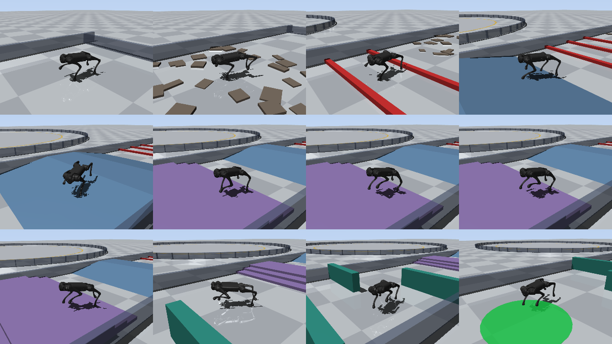

### Next
- C10 continues to 255M; benchmark reviews every 5M.
- The open goals for stage 2: reliability (≥ 4/6), then full difficulty (1.0), and course posture
  (crab is creeping up on some policies).

---

## Report 35: 2026-11-17, benchmark review: C8 seed 1 is the clear best; its gaps are the stairs and rubble → C10

Benchmark: all obstacles 0.5, 6 rubble layouts.

| Policy | Goals | Where runs stop |
|---|---|---|
| **C8 seed 1 (195M)** | **1 / 6 (42.8 s)** | **stairs ×3 (15.15 m)**, rubble ×1, past the ramp crest ×1 (12.2 m) |
| C8 seed 0 (189M) | 0 / 6 | ramp crest ×5, rubble ×1 |
| C8 seed 2 (176M) | 0 / 6 | ramp crest ×4, rubble ×2 |
| C9 seeds 0–2 (193–195M) | 0 / 6 each | ramp crest ×4–5, rubble ×1–3; 1 stairs fall |

(C8 seed 1 at 193M scored 2/6 in report 34; 1/6 at 195M is normal run-to-run variance.)

- **Working:** C8 seed 1 is consistently the best. It gets over the ramp crest and reaches the
  stairs, and occasionally the goal.
- **Not working:**
  - The other seeds and C9 mostly stall at the crest. **C9's mid-ramp spawns did not help.**
  - Crab angle on the course has drifted up for several policies (C8 seed 1: 18.8°), so the
    course posture needs work later.

Video: [course.mp4](docs/media/review_176M_20261117_0745/course_c8_seed1/course.mp4)

**Training spawns were spread evenly** over the 6 section starts, so the stairs got only about
1/6 of practice despite being the main gap.

### Change: C10 (Amarel job 63989189, 3 seeds, from C8 seed 1 at 195M → 255M, no restart)
- **`--section-weights {"stairs": 3, "rubble": 2}`**: spawn practice weighted toward the weak
  sections. Verified over 900 resets: stairs about 35 %, rubble about 20 %, others about 11 %.
- Starts at C8 seed 1's section levels (rubble, hurdles, slalom 1.0; ramp 0.65; stairs 0.55).
- No mid-ramp spawns. Everything else as C8.
- C8 and C9 continue for comparison.

---

## Report 34: 2026-11-17, measuring right: a fixed benchmark shows C8 completes 2 of 6; the rubble is the reliability gap

### Why course completions looked so rare
The per-section curriculum keeps **each obstacle at the edge of ability**: it raises a section
whenever its clear rate passes 60 %. Testing the course at the curriculum's current levels
therefore means each of 5 sections passes about 60 % of the time, and the whole course about
**0.6⁵ ≈ 8 %** *by design*. Those numbers were not comparable between reviews or runs.

**Fix:** reviews now test the course at a **fixed benchmark: every obstacle at 0.5, across 6
rubble layouts** (`COURSE_BENCH`, default 0.5). The final test will be at 1.0.

### Ramp diagnosis (resolved)
- C8 seed 1 (193M), ramp-only from the run-up: **clears 5°, 7°, 9° and 11° ramps 3/3 each**, better
  than its parent (C3 seed 1 final: 3, 3, 2, 1 out of 3).
- Off-centre starts (y = 0, ±0.4, ±0.8, −1.0 m, up to 20° yaw): **19 of 20 cleared**. Wall
  proximity is not a factor.
- So the earlier crest stalls on the full course were curriculum-frontier effects (the ramp kept
  being pushed to its edge) plus run-to-run variance, not a missing skill.

### Benchmark results (all obstacles 0.5, 6 layouts)

| Policy | Goals | Furthest points | Where it stops |
|---|---|---|---|
| **C8 seed 1 (193M)** | **2 / 6 (39.6 s, 49.7 s)** | 23.2, 23.2, 4.4, 20.0, 4.4, 3.0 | rubble ×3, slalom ×1 |
| C9 seed 2 (191M) | 0 / 6 | 4.7, 10.9 ×5 | ramp crest ×5 |

C8 seed 1 completing the benchmark course in **39.6 s** (layout 0):

Video: [course.mp4](progress/milestones/c8_seed1_193M_bench05_2of6/course.mp4). Saved as milestone [`progress/milestones/c8_seed1_193M_bench05_2of6/`](progress/milestones/c8_seed1_193M_bench05_2of6).

- **C8 seed 1 is the current best.** Its reliability gap on a fair test is the **rubble field**
  (stalls 3.0–4.4 m in), not the ramp.
- **C9 (mid-ramp spawns) hasn't helped yet:** its ramp level fell 0.85 → 0.45–0.6, and its course
  runs stop at the crest. It is about 9M steps in and still running.

### Next
- C8 finishes at 210M, C9 at 242M. Reviews now use the fixed 0.5 benchmark.
- If C8's rubble stalls persist, the next targeted tweak is for the rubble (e.g. rubble-entrance
  practice, or a check of foot clearance over blocks).

Note: an earlier commit (57c5e0f) carried this report's title but not its text, because a failed
file copy stopped the step that writes it. This entry restores it.

---

## Report 33: 2026-11-17, ramp level won't settle → C9 (practise the crest directly)

### C8 at 165–182M
The ramp's curriculum level keeps swinging while every other obstacle stays at full size:

| Run | Ramp level over training (every ~6 updates) |
|---|---|
| C8 seed 0 | 0.3 → 0.6 → 0.9 → **1.0** → 1.0 → 0.95 → 0.8 → 0.6 → **0.45** |
| C8 seed 1 | 0.3 → 0.7 → 0.5 → 0.25 → **0.2** → 0.4 → 0.7 → **0.85** |
| C8 seed 2 | 0.3 → 0.65 → 0.9 → 0.75 → 0.35 → **0.25** |

Course from the start (6 layouts): no completions. Most runs stop at the **ramp crest
(10.7–11.0 m)**. Seed 2 reached the stairs in 2 of 6. Crab stays ≤ 4.3° on seeds 0 and 2.

**The trigger from report 32 is met** (the ramp is not stabilising). The skill seems to be
learned, then forgotten. Every ramp attempt starts at the bottom, so the hard moment (getting
over the crest) is practised rarely and late in each attempt.

### Change: C9 (Amarel job 63988748, 3 seeds, from C8 seed 1 at 182M → 242M)
- **`--ramp-spawn 0.25`:** 25 % of course episodes start partway up the ramp (10.0–11.4 m, up to and
  over the crest), with the body pitched to the slope and the height set from the local ground.
  Tested: the dog stands stably on the slope at normal height.
- Mid-ramp starts don't count toward the ramp's curriculum score, so the ramp level still
  measures full climbs from the bottom.
- Starts from C8 seed 1's exact section levels: rubble, hurdles and slalom 1.0, ramp 0.85,
  stairs 0.55.
- Everything else as C8. C8 keeps running for comparison.

Small fixes: the trainer accepts a per-section starting difficulty (JSON), and the job script
quotes it. The first C9 launch exited because the JSON was split at its spaces; fixed and
relaunched.

---

## Report 32: 2026-11-17, fair 6-layout test: C8 reaches the slalom; the ramp crest is the bottleneck

Course from the start, 6 rubble layouts each, at each run's section levels:

| Run | Levels (rubble/hurdles/ramp/stairs/slalom) | Furthest points (layouts 0–5) | Falls |
|---|---|---|---|
| **C8 seed 1 (171M)** | 1.0 / 1.0 / 0.60 / 0.35 / 1.0 | 11.0, 3.5, **20.7**, 15.1, **21.0**, 15.2 | 0/6 |
| C8 seed 0 (169M) | 1.0 / 1.0 / 0.65 / 0.35 / 1.0 | 15.3, 10.8, 7.4, 6.5, 6.9, 15.1 | 1/6 |
| C8 seed 2 (160M) | 1.0 / 1.0 / 0.35 / 0.25 / 1.0 | 10.7 ×5, 6.9 | 1/6 |

- **Working:** C8 seed 1 reaches the **slalom** in 2 of 6 runs and the stairs in 3, with **no falls**,
  at full-size rubble, hurdles and slalom.
- **Not working:** no completions at these levels yet.

Video (C8 seed 1): [course.mp4](docs/media/review_160M_20261117_0641/course_c8_seed1/course.mp4)

**Slow or stuck?** Most runs ended exactly at the 60 s limit, so I re-ran 4 layouts with 120 s.
Section clear times:

| Layout | rubble | hurdles | ramp | then |
|---|---|---|---|---|
| 2 | 7 s | 15 s | 58 s | fell at 14.2 m |
| 3 | 7 s | 16 s | — | stuck at the crest (11.0 m) until 120 s |
| 4 | 8 s | 17 s | 119 s | |
| 5 | 7 s | 13 s | — | stuck at the crest (11.0 m) until 120 s |

**The ramp crest is the bottleneck** (11° at level 0.6). Rubble and hurdles are fast. The dog
then spends 40–100 s on the ramp or never crests it. That's why the curriculum keeps moving the
ramp level up and down (0.35–0.7).

**Decision:** no change yet; the curriculum is still adapting. If the ramp hasn't stabilised by the
next review, the next tweak (C9) is **spawning some episodes partway up the ramp**. Every ramp
attempt now starts at the bottom, so cresting the top only gets practised after a full climb.

---

## Report 31: 2026-11-17, rubble, hurdles and slalom at full size; evaluation made fairer (6 rubble layouts)

### C8 curriculum (161–169M)

| | rubble | hurdles | ramp | stairs | slalom | goal rate (training) | falls |
|---|---|---|---|---|---|---|---|
| C8 seed 0 | **1.0** | **1.0** | 0.70 (was 1.0) | 0.45 | **1.0** | 15 % | 26 % |
| C8 seed 1 | **1.0** | **1.0** | 0.25 | 0.15 | **1.0** | 26 % | 28 % |
| C8 seed 2 | **1.0** | **1.0** | 0.50 | 0.35 | **1.0** | 12 % | 13 % |

- **Working:** rubble, hurdles and slalom have all reached **full size** on every seed.
- **Not working:**
  - The ramp level oscillates: the curriculum lowers it when the clear rate drops below 20 %.
  - The **stairs** are the slowest obstacle (0.15–0.45).

### Evaluation fix: one fixed rubble layout was misleading
Rubble blocks are placed from a random seed. Training uses 30 layouts (one per simulation), but
the course test always used layout 0. The same C8 policy, at the same settings, on six layouts
(2 runs each):

| Layout | 0 | 1 | 2 | 3 | 4 | 5 |
|---|---|---|---|---|---|---|
| result | fell 7.9 / stall 10.8 | 19.5 / fell 21.3 | fell 5.3 / 10.8 | fell 13.0 / **GOAL** | 10.8 / 10.8 | 10.9 / 19.8 |

So the review's "stalls at the rubble entrance" partly reflected one unlucky layout.

**Changes:**
- **The course test now runs 6 times, once per rubble layout (0–5).** The goal-rate goal is now
  ≥ 4 of 6.
- **Reviews evaluate only the active line (C8).** Superseded runs (C5–C7) finish untouched but are
  no longer evaluated. Each course test now takes several minutes.

With the new test, C8 seed 1 (169M): furthest points 4.7 / 5.4 / **17.3** / 10.9 / 10.9 / 7.1 m.
The stops are spread across the rubble, hurdles, ramp top and stairs, with no completion at these
harder levels yet.

### Next
- C8 keeps training. The curriculum is still adjusting the ramp and stairs.
- If the stairs stay below 0.5 for two more reviews, consider a targeted stairs tweak
  (e.g. stairs-only spawn share).

---

## Report 30: 2026-11-17, 🏁 C8 crosses the course with FULL-SIZE hurdles, ramp and slalom

### C8 per-section curriculum after about 8–12M steps (training)

| | rubble | hurdles | ramp | stairs | slalom | goal rate (training) |
|---|---|---|---|---|---|---|
| **C8 seed 0** | 0.75 → 0.85 | **1.0** | **1.0 (15°)** | 0.50–0.55 | **1.0** | 29 % |
| C8 seed 1 | 0.60 | **1.0** | 0.50 | 0.35 | 0.90 | 13 % |
| C8 seed 2 | 0.55 | 0.80 | 0.85 | 0.55 | 0.95 | 28 % |
| C7 (wrong parent) | 1.0 | 0.9–1.0 | **0.0–0.05** | **0.0–0.05** | 0.65–0.95 | 7–15 % |

**The parent-branch finding is confirmed.** From C3 seed 1, the ramp went to full 15° within
about 10M steps. From C3 seed 0 (C7), the curriculum had to lower the ramp all the way to 0.

### Course from the start (C8 seed 0, 152M, at its own section levels)
**Reached the goal in 55.2 s** with full 11 cm hurdles, the full 15° ramp and full slalom gates
(rubble 0.85, stairs 0.55). In the evaluation's 3 runs: 1 goal, 1 fall in the slalom at 21.2 m,
1 stall at the rubble entrance.

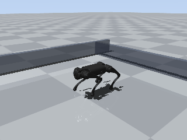

Video: [course_goal.mp4](progress/milestones/c8_seed0_152M_full_ramp_hurdles_slalom/course_goal.mp4). Frames:
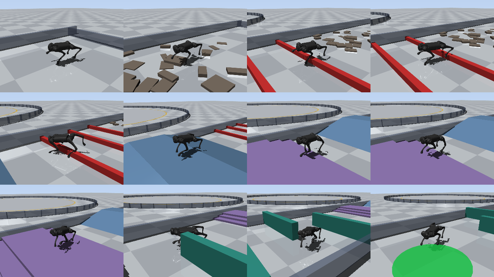

Saved as milestone [`progress/milestones/c8_seed0_152M_full_ramp_hurdles_slalom/`](progress/milestones/c8_seed0_152M_full_ramp_hurdles_slalom) (policy, normalisation, its section difficulties, videos).

### Still to fix
- **Reliability:** 1 in 3 from the start. The rubble entrance stalls in some runs (C8 seed 2 at
  2.4–2.6 m in all 3).
- **Stairs** at 0.5–0.55 of full height; **rubble** at 0.55–0.85.
- **Gait while crossing:** crab 4.9° (✅), but shin/knee contact about 72 %, so it scrapes the
  obstacles.
- All C1–C7 runs are superseded by C8. They keep running to completion under the no-restart rule.

### Bug fixed
The progress summary crashed on per-section difficulty (a dict). That's why C7/C8 were missing
from one review. Fixed and re-reviewed.

### Next
- C8 keeps training. The curriculum should push stairs and rubble up.
- Reviews test the full course from the start at the current levels.
- After that: reliability (3/3), the course gait (shin contact), and a final test at full
  difficulty everywhere.

---

## Report 29: 2026-11-17, per-obstacle curriculum isolates the problem; the climbing skill was in the other branch → C8

### C7: what the per-section curriculum shows (about 4–6M steps in)

| Obstacle | Level (seeds 0 / 1 / 2) | Clear rate |
|---|---|---|
| rubble | **0.75 / 0.60 / 0.60** ↑ | 71–78 % |
| hurdles | **0.75 / 0.60 / 0.60** ↑ | 73–79 % |
| slalom | 0.45 / 0.45 / 0.50 | 53–79 % |
| ramp | **0.05 / 0.20 / 0.15** ↓ | 0–13 % |
| stairs | **0.15 / 0.25 / 0.25** ↓ | 0–5 % |

Freed from the ramp, rubble and hurdles rose quickly. The ramp and stairs kept being *lowered*,
but were rarely cleared even at their easiest. A trace confirmed it: even at a 5.5° ramp the C7
policy stalls about 0.5 m below the crest, and on the stairs it stalls at the first step.

### Finding: the climbing skill lives in a different branch
The C4 → C5 → C6 → C7 line was continued from **C3 seed 0**. Testing **C3 seed 1** instead,
starting on the ramp run-up and checking whether it clears the ramp:

| Policy | Physics | 5° ramp | 7° ramp | 9° ramp |
|---|---|---|---|---|
| C3 seed 1 at 90M (milestone) | slippery / realistic | ✅✅ / ✅✅ | ❌ / ❌ | ❌ / ❌ |
| **C3 seed 1 final (140M)** | slippery | ✅✅ | ✅✅ | ✅✅ |
| **C3 seed 1 final (140M)** | **realistic** | ✅✅ | ✅✅ | ✅ (1 of 2) |

C3 seed 1 **learned to climb during its last 50M steps**, after I had already branched C4 from
seed 0, which never had the skill. Choosing the branch by "reached the stairs at that review" was
the wrong criterion.

Full course, C3 seed 1 final with realistic friction:
- difficulty 0.3: one run reaches the goal
- difficulty 1.0: one run gets past the full 15° ramp (13.6 m)
- weak spots: **rubble at larger sizes** (stalls about 4.5 m) and **the stairs** (about 15 m)

### Change: C8 (Amarel job 63987675, 3 seeds, from C3 seed 1 final at 140M → 210M, no restart)
- Start from the lineage that can climb.
- Apply only the verified or principled fixes:
  - **realistic friction** (bug fix)
  - **terrain-relative tilt**
  - **per-section curriculum** (all obstacles start at 0.3; each moves ±0.05 by its own clear
    rate)
- C4's unproven changes (10 cm lift, collision −4) are **left out**, so C8 vs C7 also tests them.
- C7 keeps running as the comparison.

**Lesson (logged):** when branching a continuation, pick the parent by testing the specific skill
(e.g. ramp clear rate per slope), not by one course run. Skills can appear late in a run.

---

## Report 28: 2026-11-17, every policy stalls at the same spot → per-obstacle curriculum (C7)

### Review at 141–160M (C5, C6, difficulty 0.4)

| Run | Furthest point (3 runs) | Crab | Shin contact |
|---|---|---|---|
| C5 seeds 0–2 (143–153M) | 10.76–10.86 / 3.4–7.1 | 12–24° | 63–81 % |
| C6 seed 0 (141M) | 10.77 / 3.75 / 10.75 | **2.0°** | 77 % |
| C6 seed 1 (141M) | 7.3 (fell) / 10.76 / 10.74 | **7.1°** | 66 % |
| C6 seed 2 (141M) | 4.9 / 6.1 / 10.82 | **8.3°** | 79 % |

- **Working:** terrain-relative tilt (C6) brought the crab angle back under the 10° goal on every
  seed (C5: 12–24°).
- **Not working:** every policy from C3 to C6, with either friction model, stalls at
  **10.74–10.86 m**, just below the top of the 9° ramp.

### Investigation
- **Geometry is clean.** Ray-cast heights rise smoothly to 0.238 m at the crest (11.1 m). No lip,
  no wall; all wall sensors read open (3 m).
- **The dog rocks back and forth.** Forward speed alternates about ±0.5 m/s with each half-stride,
  so the position oscillates between 10.55 and 10.8 m.
- **The reward prefers climbing** (progress, speed and alignment all fall while stuck). Motors are
  *less* loaded on the slope than on flat ground. Foot slip is the same as on flat ground.
- **Exploration is healthy** (log std about −1.5, not collapsed).
- **The curriculum itself is stuck.** C5 sat at difficulty 0.4 for 35M steps (125 → 161M). The
  single global difficulty only rises when the mean distance per episode exceeds 5 m, and the
  ramp blocks that, so *every* section is frozen by one obstacle. The jump from 8° (passable once,
  at 0.3) to 9° is a step the policy can't make.

### Change: C7, a per-section curriculum (Amarel job 63987554, 3 seeds, from C6 seed 1 at 149M → 209M)
- Each obstacle (rubble, hurdles, ramp, stairs, slalom) has **its own difficulty**.
  - It rises **+0.05** when that section is cleared in ≥ 60 % of the last 100 attempts.
  - It drops **−0.05** when < 20 %.
  - So the ramp gets **0.5° steps at its own pace** while the other sections keep growing.
- An attempt counts when the dog spawns on that section's run-up or reaches it. A clear means
  passing its checkpoint.
- Tested: geometry follows each section's level (hurdle 6.2 cm at 0.4, ramp 8.0° at 0.3 and 8.5°
  at 0.35). Results are recorded per section. The rule lowers a section at 10 % clear rate and
  raises it at 70 %.
- Everything else as C6: real friction, terrain-relative tilt, 10 cm lift, collision −4,
  entropy 0.002, run-up spawns.

Old runs: C4 (slippery physics), C5 and C6 keep running to completion (no-restart rule). Their
results are superseded.

---

## Report 27: 2026-11-17, real friction alone isn't enough → second flat-ground assumption fixed (C6)

### C5 first review (realistic friction, difficulty 0.4, about 7M steps in)

| Run | Furthest point | Crab | Shin contact | Roll / pitch |
|---|---|---|---|---|
| C5 seed 0 (132M) | 10.7 / 4.6 (fell) m | 21° | 78 % | 0.4° / 1.5° |
| C5 seed 1 (135M) | 10.75 / 10.75 m | 19° | 63 % | 0.6° / 2.5° |
| C5 seed 2 (131M) | 3.1 / 8.9 m | 26° | 64 % | 2.1° / 2.6° |

Still stalls just below the ramp top (about 10.75 m), even with real grip. So slipping was not the
whole story.

### Second cause: the posture penalty assumed flat ground
E9's `orientation` penalty (weight −30) punishes any body tilt **relative to gravity**. On the 9°
ramp a real dog's body follows the slope, but ours is forced to stay **horizontal**: front legs
stretched, rear legs crouched. That matches what the traces showed: calf motors at 100 % of their
force limit and rear shins scraping the ramp (63–78 % shin contact), stalling where the slope is
steepest. The very low pitch numbers (1.5–2.6° on a 9° ramp) show how strongly it holds the body
level.

### Change: C6 (Amarel job 63987272, 3 seeds, from C5 seed 1 at 135M → 195M, no restart)
- **`--terrain-relative-tilt`**: body roll and pitch are penalised relative to the **local ground
  slope** along the heading (heights 0.3 m ahead and behind), not gravity.
- Verified: body parallel to the ground scores 0 on the up-ramp, flat ground and the down-ramp.
  A level body on the 9° ramp is now the penalised pose.
- Flat-ground behaviour is unchanged (the ground pitch is 0).
- Everything else as C5: real friction, 10 cm foot lift, collision −4, entropy 0.002, difficulty
  0.4, run-up spawns. The old gravity-relative line is kept commented with the reason.

C1–C4 (slippery physics) keep running to completion. C3 has finished.

---

## Report 26: 2026-11-17, 🐞 physics bug found: the ramp was nearly frictionless → C5 with realistic friction

### What the reviews showed
At difficulty 0.4, C3 and C4 policies stalled on the upper ramp (10.4–10.9 m) in every
deterministic *and* random-action run. Training made progress section by section, but no policy
climbed the steeper ramp from the start.

### Investigation
A step-by-step trace on the 9° ramp showed the dog **sliding backwards**: forward speed swung
between +0.45 and −0.65 m/s while it trotted in place, regaining and losing the same 0.5 m. A
9° slope should be trivial for a Go1 (needs a friction coefficient > 0.16; the feet have 0.8).

**Cause:** when the Go1 was merged into the course (E4), its contact settings were overwritten to
the course's defaults to silence a merge warning: a *pyramidal* friction cone with `impratio = 1`.
The Menagerie Go1 specifies an *elliptic* cone with `impratio = 100` for firm grip.

**Proof** (Go1 standing still on the ramp, zero action, 3 s + 6 s):

| Friction model | 9° ramp | 15° ramp | Sim speed |
|---|---|---|---|
| pyramidal, impratio 1 (used E1–C4) | **slid 56 cm, then 39 cm more** | slid 80 cm | 1,438 steps/s |
| elliptic, impratio 100 (Menagerie) | settles 3.5 cm, then **0.2 cm** | 5.5 cm, then 0.1 cm | 1,479 steps/s |

On flat ground the effect was small, so the stage-1 walking results stand. On slopes the dog was
effectively on ice.

### Change: C5 (Amarel job 63987102, 3 seeds, from C4 seed 1 at 124M → 190M, no restart)
- **`--friction-model elliptic`**: realistic grip (Menagerie settings). No speed cost.
- Curriculum starts at **0.4** (C4's level) via the new `DIFF` option.
- C4 rewards kept: 10 cm foot lift, collision −4, entropy 0.002, run-up spawns.
- The friction model is an explicit option (`course.build_model(friction_model=...)`). The old
  setting stays the default so the running C1–C4 jobs keep consistent physics. Evaluation uses
  each run's own setting from its config.

Quick check: C4 seed 1, trained on slippery physics, with real friction gets past the ramp in 1 of 3
runs (15.2 m) but isn't adapted. C5 trains it on the real physics.

---

## Report 25: 2026-11-17, stairs and shin scraping not improving → C4 (higher steps, stronger shin penalty)

Course from the start at each run's curriculum difficulty (C3 now at 0.3–0.4):

| Run | Furthest point (3 runs) | Goal | Shin contact |
|---|---|---|---|
| C3 seed 0 (111M) | **14.9 / 15.4 / 17.3 m** (stairs; 1 fall) | 0/3 | 50 % |
| C3 seed 1 (111M) | 17.6 / 4.7 / 4.6 m | 0/3 | 66 % |
| C3 seed 2 (111M) | 10.9 ×3 (ramp top) | 0/3 | 46 % |
| C2 seeds 1–2 | 10.6 ×3 | 0/3 | 42–59 % |
| C1 ×3, C2 seed 0 | 6.7–9.95 | 0/3 | 25–28 % |

- **Working:** C3 seed 0 now reaches the stairs in every run at difficulty 0.3.
- **Not working:**
  - The stairs stop or topple it.
  - Shin contact on the course is 46–66 %: legs hit obstacle edges, especially stair risers.
  - No completions at the higher difficulty.

This is the trigger from report 24 (stair falls and shin scraping not improving).

Video (C3 seed 0, reaching the stairs): [course.mp4](docs/media/review_95M_20261117_0254/course_c3_seed0/course.mp4)

**Change: C4** (Amarel job 63986196, 3 seeds, from C3 seed 0 at 111M → 170M, no restart):
- **Foot lift target 8 → 10 cm** (`--swing-height 0.10`), so swing feet clear stair risers and
  hurdle bars.
- **Shin/knee/belly contact penalty −2 → −4** (`collision`): hitting edges with the legs costs
  more; stepping over pays.
- Entropy bonus 0.002 kept (no exploration reset). Run-up spawns kept. Other rewards unchanged.
- Note: C4's curriculum restarts at difficulty 0 (the job script default). It should re-climb
  quickly. A `DIFF` option now lets later continuations start at the source run's level.

C1 (no exploration fix) is still stuck at the ramp foot after 30M course steps. It ends at 126M.

---

## Report 24: 2026-11-17, curriculum rising (difficulty 0.3): obstacles grow, stairs now the hard part

Course from the start, each run tested at its **own current curriculum difficulty**:

| Run | Train difficulty | Furthest point (3 runs) | Goal | Shin contact |
|---|---|---|---|---|
| **C3 seed 1 (100M)** | 0.2–0.3 | 14.6 (fell) / 15.2 (fell) / **23.2 ✅** | **1/3** | 49 % |
| C3 seed 0 (100M) | 0.3 | 10.3 / 10.7 / 10.3 | 0/3 | 62 % |
| C3 seed 2 (100M) | 0.3 | 10.1 / 10.1 / 10.3 | 0/3 | 60 % |
| C2 seeds 1–2 (99–105M) | 0.1 | 10.6 ×3 | 0/3 | 42 % |
| C1 ×3, C2 seed 0 | 0.0 | 9.7–9.9 | 0/3 | 23–34 % |

**What's working**
- **The curriculum is advancing.** C3 is training at 0.3, so hurdles are about 5.4 cm, steps about
  4.8 cm and the ramp about 8°. C2 is at 0.1.
- C3 seed 1 still completes the bigger course in 1 of 3 runs. It clears hurdles and the ramp, then
  **tips over at the first stair** in the other two runs.

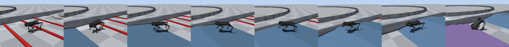
Video: [course.mp4](docs/media/review_90M_20261117_0232/course_c3_seed1/course.mp4)

**What's not working**
- **Shin contact is rising** (49–62 % for C3): legs scrape the bigger obstacles.
- Seeds 0 and 2 of C3 stall partway up the steeper ramp.
- Training falls: 18–30 %.

**Decision:** no change yet. Curriculum steps always cause a temporary dip. If stair falls and shin
contact don't improve by the next review, the course-gait tweak is next: higher swing height on
obstacles, or a stronger collision penalty only for shins hitting obstacle edges.

Tooling fix: review videos for course runs now come from the run that gets furthest (it used to
pick a run stuck at the ramp).

---

## Report 23: 2026-11-17, 🏁 FIRST COURSE COMPLETION: start → goal, 3 out of 3 runs (difficulty 0)

**C3 seed 1 at 90M** (4M steps after the exploration reset) crosses the whole obstacle course from
the start line to the goal pad: **3/3 runs, no falls, in 44.7 / 45.9 / 55.5 s**.

Full-run video for slides: [course.mp4](progress/milestones/c3_seed1_90M_first_course_completion/course.mp4). Saved as milestone
[`progress/milestones/c3_seed1_90M_first_course_completion/`](progress/milestones/c3_seed1_90M_first_course_completion).

The run frame by frame: start → rubble → hurdles → ramp up → ramp down → stairs → slalom → goal
pad:
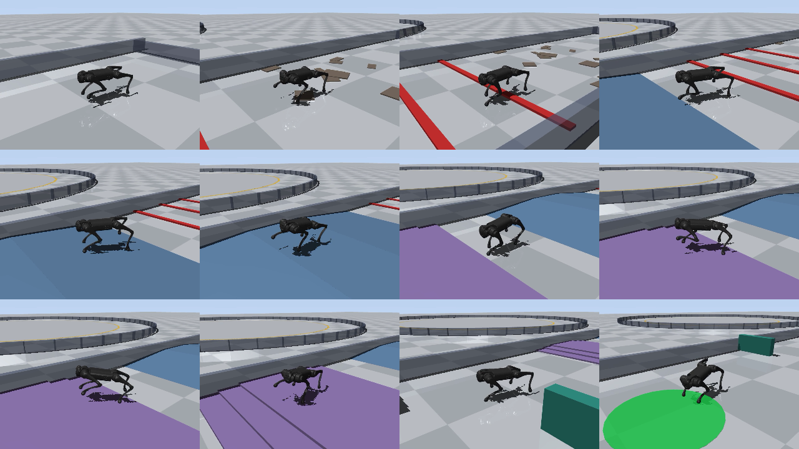

### All runs at this review (course from the start, difficulty 0)

| Run | Furthest point | Goal | Note |
|---|---|---|---|
| **C3 seed 1 (90M)** | **23.2 m ×3** | ✅ **3/3** | full course |
| C3 seed 2 (91M) | 11.7 m | 0/3 | onto the ramp; 20 % falls |
| C3 seed 0 (91M) | 3.9 m | 0/3 | stopped in rubble (exploration noise is still settling) |
| C2 seed 1 (91M) | 10.9 m | 0/3 | C2 also starting to get past the ramp foot |
| C2 seed 2 (96M) | 10.3 m | 0/3 | |
| C1 ×3, C2 seed 0 | 9.6–9.7 m | 0/3 | still stuck at the ramp foot |

**The exploration reset was the key.** Policies with collapsed exploration (C1, most of C2) are
still stuck at the ramp foot. C3 completed the course within 4M steps of the reset.

### Gait while crossing the course (C3 seed 1)

| Goal | Value | |
|---|---|---|
| body straight (crab) | 2.4° | ✅ |
| level body (roll / pitch) | 1.5° / 0.2° | ✅ |
| feet under the hips (sideways / fore-aft) | 3.6 / 7.8 cm | ✅ |
| shins/knees touching ground or obstacles | **46 %** | ❌ |
| step heights equal across legs | spread 93 % | ❌ |
| pace on open ground | 0.18 m/s off target | ❌ |

It crosses with a straight, level body, but it scrapes its shins (on obstacles and steps) and
steps unevenly. Making the course crossing *look natural* is the next target, after it handles
bigger obstacles.

### Curriculum
C3 seed 1 has raised the difficulty to **0.2** (obstacles 20 % of the way to full size). Training
goal rate is 21 %. Full difficulty is 1.0.

### Next
- Keep training (no change). The curriculum grows the obstacles automatically.
- Each review tests the course from the start at the current difficulty.
- Then the course gait (shin contact, step evenness), and a final test at difficulty 1.0.

---

## Report 22: 2026-11-17, C3 (exploration reset): first steps onto the ramp

**C3 training** (3M steps since the exploration reset):

| | 86.1M (reset) | 86.9M | 88.6M |
|---|---|---|---|
| falls per episode | 100 % | 66 % | **18–27 %** |
| distance per episode | 0.8 m | 2.3 m | 3.0–3.8 m |
| goal reached (training) | 0 % | 5–7 % | 12–14 % |

As expected, the extra randomness first made it fall in every episode. It recovered within
about 2.5M steps. Exploration is holding (log std about −1.28, vs −2.8 before), so no
re-collapse.

**On the course from the start (89M checkpoints, 2 runs each):**

| Run | Furthest point | Before (C1/C2) |
|---|---|---|
| C3 seed 0 | **10.10 / 10.08 m** | 9.61–9.69 m |
| C3 seed 1 | **10.02 / 9.99 m** | |
| C3 seed 2 | 9.89 / 9.81 m | |

**First progress past the ramp edge:** it now steps *onto* the ramp, 0.2–0.5 m up the slope, where
before it froze at the edge every time. It still times out partway up.

C1 and C2 at 82–90M: still stuck at 9.6–9.8 m in every run (the comparison confirms the effect
is from the exploration reset).

**Decision:** no change. C3 is only 3M steps in and moving in the right direction. Next review at
about 90M.

---

## Report 21: 2026-11-17, ramp still blocks every run → root cause: exploration had collapsed → C3 launched

### Review at 76–80M (C1 and C2, difficulty 0)
Every run of all six policies stops at **x = 9.61–9.69 m**, the ramp foot (the ramp starts at 9.6 m).
That includes C2, which practised that exact approach for 6–14M steps. Rubble and hurdles stay
reliable (no falls). Trot is 0.68–0.75 (seed 1 of C2 passes 0.75), pitch now ≤ 4° on 5 of 6 runs,
shin contact about 24 %.

### Investigation (each hypothesis tested, in order)

| Hypothesis | Test | Result |
|---|---|---|
| Physical step at the ramp edge | ray-cast ground profile and box corners | ❌ the ramp starts flush at 0 cm, 5° slope |
| Reward makes standing better | per-term reward: walking vs stuck | ❌ walking 6.3/s vs stuck 2.5/s: reward clearly prefers moving |
| Deterministic evaluation hides a solution | 4 runs with training-style random actions | ❌ stuck at 9.7 m every time |
| Observation normaliser saturated by terrain | normalised height-scan inputs at the ramp | ❌ within ±2.7 (no clipping) |
| Actions saturated | raw action values while stuck | ❌ only 1 of 12 joints at its limit |
| **Exploration collapsed** | policy log std | ✅ **about −2.8, i.e. noise of ±0.06** on a ±1 action scale |

**Root cause.** PPO here has no entropy bonus (`ent_coef = 0`, as in the original course setup).
After about 80M steps the policy became almost deterministic. On flat ground that is fine, but at
the ramp it never tries a meaningfully different leg movement, so it can never discover how to
step up. Ramp practice alone (C2) could not help.

At the ramp foot the dog freezes mid-stride, standing on one diagonal pair of feet (front-right
on the ramp, rear-left on the floor) with the front-left foot held 8.6 cm up.

### Change: C3 (Amarel job 63986078, 3 seeds, from C2 seed 1 at 86M → 140M, no restart)
- `--reset-log-std -1.2`: exploration noise back to about ±0.3
- `--ent-coef 0.002`: a small entropy bonus so it doesn't collapse again
- Run-up spawns (C2) and all rewards unchanged. C1 and C2 keep running.
- Expect the gait to get noisier briefly while it explores.

---

## Report 20: 2026-11-17, still stopping at the ramp → C2 launched (spawn-position bug fixed)

C1 at 70M (4–5M course steps, difficulty 0):

| Run | Furthest point (3 runs) | Course falls | Trot | Shin contact | Roll / pitch |
|---|---|---|---|---|---|
| C1 seed 0 | 9.47 / 9.64 / 9.47 m | 0/3 | 0.66 | 24 % | 8.0° / 7.6° |
| C1 seed 1 | 9.50 / 9.50 / 9.50 m | 0/3 | 0.66 | 25 % | 3.7° / 5.6° |
| C1 seed 2 | 9.40 / 7.59 / 9.43 m | 1/3 | 0.67 | 24 % | 8.1° / 8.8° |

- **Working:** rubble and hurdles are now cleared reliably from the start, with no falls.
- **Not working:** every run still stops at the ramp foot (9.4–9.6 m), so the trigger rule
  applies.

**Root cause: a spawn bug in the original course code.** Training spawns at "section start
+ 0.8 m" put the dog *on* the ramp (10.0 m; the ramp foot is at 9.6 m) and *on* the first stair
(15.0 m vs 14.6 m). So it never practised stepping onto the ramp or the stairs from flat ground,
which is exactly where it freezes.

**Change: C2** (Amarel job 63985737, 3 seeds, from C1 seed 1 at 70M → 130M, no restart; C1 keeps
running): `--spawn-offset 0.15`, so section spawns sit on the flat run-up with all four feet
before each obstacle (ramp 9.35 m, stairs 14.35 m; checked: ground height 0 under every foot).
Rewards are unchanged.

**Still to win back on the course:** a natural gait. Trot match is 0.66 (goal ≥ 0.75), shin contact
24 %, roll/pitch up to 8–9°. If these don't improve once the ramp is solved, the next tweak will
target the course gait.

---

## Report 19: 2026-11-17, stage 2 first review: rubble and hurdles cleared; stops at the foot of the ramp

Course from the start, difficulty 0 (1–2M steps into C1):

| Run | Furthest point (3 runs) | Sections cleared | Goal | Falls (course runs) |
|---|---|---|---|---|
| C1 seed 0 (67M) | 9.49 / 7.55 / 9.49 m | rubble, hurdles | 0/3 | 1/3 |
| C1 seed 1 (67M) | 7.41 / 9.49 / 9.50 m | rubble, hurdles | 0/3 | 1/3 |
| C1 seed 2 (68M) | 9.49 / 9.49 / 9.48 m | rubble, hurdles | 0/3 | 1/3 |

**Big step from the baseline:** before stage 2 the dog moved 0.1 m and fell. Now it trots through
the rubble and over the hurdles (about 0.63 m/s) in most runs.

| Before stage 2 (ring policy) | After 1–2M course steps |
|---|---|
|  |  |

Full-run video: [course.mp4](docs/media/review_67M_20261117_0100/course_c1_seed0/course.mp4)

**Where it gets stuck:** in every run it stops at x ≈ 9.2–9.5 m, just before the ramp (starts at
9.6 m). It turns about 45° to the left and stands still until time runs out. It is not touching a
wall (nearest 1.4 m). Traced step by step: speed drops from 0.65 to 0 m/s as the slope appears in
its height scan, which it never saw in the ring.
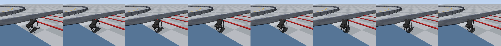

**Gait on the course has degraded** (expected this early): roll/pitch 8–12°, shin contact 22–32 %,
speed in the random-section walking test about 0.01–0.07 m/s (mostly standing). Natural gait has
to be won back on the course.

**Training stats:** distance per episode 3.4–3.5 m, still below the 5 m curriculum threshold, so
difficulty is still 0. 9–14 % of training episodes already reach the goal (those spawned at later
sections).

**Decision:** no reward change yet. It is only 1–2M steps in, and the ramp foot is a rare training
moment (ramp-section spawns start *on* the slope). If the ramp is still a wall at the next review,
the tweak is to add spawns just before the ramp (and before the stairs).

**Tooling fixes:** the watcher now counts course jobs as running. Review videos now come from the
course runs.

---

## Report 18: 2026-11-17, ✅ final walking policy (milestone 4) + 🚀 STAGE 2 (obstacle course) launched

### Stability: all 6 runs pass all 12 goals (review at 65–69M)

| Run | Walls | Trot | Speed | Crab | Fore-aft | Splay | Step spread | Track |
|---|---|---|---|---|---|---|---|---|
| E12 seed 0 final | 100 % | 0.96 | 0.56 | 0.3° | 4.6 cm | 1.8 cm | 12 % | 0.33 m |
| **E12 seed 1 final** | **100 %** | **0.97** | **0.59** | **0.4°** | **4.1 cm** | **2.5 cm** | **9 %** | **0.06 m** |
| E12 seed 2 final | 100 % | 0.96 | 0.61 | 0.3° | 4.3 cm | 2.1 cm | 4 % | 0.30 m |
| E13 seed 0 (65M) | 100 % | 0.97 | 0.61 | 0.3° | 3.6 cm | 2.4 cm | 10 % | 0.41 m |
| E13 seed 1 (69M) | 100 % | 0.97 | 0.62 | 0.5° | 3.1 cm | 1.8 cm | 6 % | 0.13 m |
| E13 seed 2 final | 83 % | 0.96 | 0.58 | 1.5° | 3.4 cm | 2.0 cm | 3 % | 0.13 m |

### Milestone 4 = final walking policy: [`progress/milestones/e12_seed1_66M_final_walking/`](progress/milestones/e12_seed1_66M_final_walking)
**E12 seed 1, final (66M).** Chosen because it passed all 12 goals at **two consecutive reviews**
(63M and final). E13 seed 1 scores slightly better on fore-aft offset, but it fell 40 % of the
time one review earlier, so it is not proven stable.

| Walking | Wall test |
|---|---|
|  |  |

Videos: [walk.mp4](progress/milestones/e12_seed1_66M_final_walking/walk.mp4) · [wall.mp4](progress/milestones/e12_seed1_66M_final_walking/wall.mp4)

**The walking journey, in one table**

| Fix | Problem it solved | Result |
|---|---|---|
| E7 capped progress + trot reward | sprinting/bounding (E6) | natural diagonal trot |
| E9 body alignment | body slanted 31° (crabbing) | crab 0.1–0.5° |
| E10 wall-situation practice | stuck or freezing at walls | walls 100 %, stable |
| E12/E13 foot placement + swing shape/overshoot | legs slanted, uneven steps | feet under hips, steps within 9 % |

### 🚀 Stage 2 launched: obstacle course (C1)
- Amarel job 63985544, 3 seeds, from milestone 4 (66M → 126M, about 2 h).
- The healthy dog learns to cross the course from the start to the goal pad.
  - Obstacles start tiny (difficulty 0) and grow by 0.1 each time the mean distance per
    episode exceeds 5 m.
  - Episodes are 60 s. Spawns are at random section starts so every obstacle gets practice.
- All natural-gait rewards are kept (`swing_shape` 0.5 so it can lift higher for obstacles).
- Every review runs the **whole course from the start** at the current difficulty: distance,
  sections cleared, goal reached, falls, gait goals, and a video of the run.
- Baseline before training: the ring policy at the course start moves 0.1 m and falls.

---

## Report 17: 2026-11-17, ✅ legs fixed: straight, under the body, uniform steps (E12/E13); stability check next

| Run | Fore-aft | Sideways | Step heights FR/FL/RR/RL (cm) | Spread | Walls | Falls | All 12 goals |
|---|---|---|---|---|---|---|---|
| E12 seed 0 (63M) | ✅ 5.1 | ✅ | 7.8 / 8.4 / 8.8 / 8.1 | ✅ 11 % | ✅ 100 % | ✅ 0 % | ✅ |
| E12 seed 1 (63M) | ✅ 5.1 | ✅ | 7.9 / 7.4 / 8.4 / 7.8 | ✅ 13 % | ✅ 100 % | ✅ 0 % | ✅ |
| E12 seed 2 (62M) | ✅ 4.9 | ✅ | 8.4 / 8.1 / 8.1 / 7.6 | ✅ 10 % | ✅ 83 % | ❌ 20 % | ✗ |
| E13 seed 0 (60M) | ✅ 5.0 | ✅ | 8.0 / 7.8 / 8.3 / 7.7 | ✅ 8 % | ✅ 83 % | ✅ 0 % | ✅ |
| E13 seed 1 (61M) | ✅ 5.7 | ✅ | 7.7 / 8.1 / 8.3 / 7.6 | ✅ 8 % | ✅ 100 % | ❌ 40 % | ✗ |
| **E13 seed 2 (63M)** | ✅ **4.3** | ✅ **2.2** | **8.2 / 7.7 / 7.9 / 7.9** | ✅ **6 %** | ✅ **100 %** | ✅ 0 % | ✅ |

**Best: E13 seed 2 at 63M passes all 12 goals.** Trot 0.96, 0.60 m/s, crab 0.4°, roll 0.8°,
pitch 0.6°, splay 2.2 cm, fore-aft 4.3 cm, step spread 6 %, walls 100 %, no falls.

**Front view, before and after** (same camera: walking straight toward it):

Milestone 3: legs angled outward, uneven lift
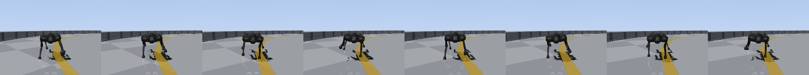

E13 seed 2: legs straight down and parallel, even steps
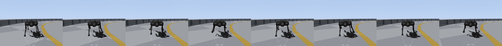

**What worked**
- **E12 (stronger weights)** fixed foot placement and gave even steps on 2 seeds by 63M.
- **E13's `swing_overshoot`** got there fastest and most cleanly (spread 6–8 % on every seed).
- Note: E12 had also caught up by 63M. The front-right leg's high step went away with more
  training under the stronger `swing_shape`. The overshoot penalty mainly sped it up.

**Watch:** two runs fall in 20–40 % of walking episodes (E12 seed 2, E13 seed 1). Policies are
picked by evaluation, and the chosen one has 0 % falls.

**Next:** if E13 seed 2 (or another seed) passes all 12 goals again at the next review, it
becomes **milestone 4, the final walking policy**, and **stage 2 (obstacle course) launches on
Amarel** from it.

Walking video (E12 seed 0, all goals): [walk.mp4](docs/media/review_60M_20261117_0029/ring_e12_seed0/walk.mp4)

---

## Report 16: 2026-11-17, E12 fixes foot placement; one leg still steps high → E13 (overshoot penalty)

| Run | Fore-aft | Sideways | Step heights FR/FL/RR/RL (cm) | Spread | Walls | Falls |
|---|---|---|---|---|---|---|
| E11 seed 0 final (66M) | ✅ 8.0 | ✅ 3.9 | 11.2 / 8.6 / 8.4 / 7.8 | ❌ 38 % | 100 % | ❌ **40 %** |
| E11 seed 1 (62M) | ❌ 9.9 | ✅ 4.2 | 13.7 / 8.1 / 8.7 / 7.7 | ❌ 62 % | 100 % | 0 % |
| E11 seed 2 (62M) | ❌ 9.0 | ✅ 3.7 | 9.6 / 7.5 / 8.9 / 8.5 | ❌ 25 % | 100 % | 0 % |
| **E12 seed 0 (55M)** | ✅ **7.3** | ✅ 3.6 | 14.8 / 8.1 / 8.4 / 8.3 | ❌ 67 % | 100 % | 0 % |
| E12 seed 1 (55M) | ❌ 8.5 | ✅ 3.7 | 13.3 / 7.8 / 8.6 / 8.3 | ❌ 58 % | 67 % | 0 % |
| **E12 seed 2 (55M)** | ✅ **6.9** | ✅ 3.5 | 14.7 / 7.9 / 8.6 / 8.4 | ❌ 69 % | 100 % | 0 % |

**What's working**
- **Stronger weights fixed foot placement within 4M steps.** E12 seeds 0 and 2 now plant the feet
  under the hips: fore-aft 6.9–7.3 cm (was 11.3), sideways 3.5–3.6 cm.
- Three of the four legs now step at a uniform about 8 cm.

**What's not working**
- **The front-right leg alone still lifts 13–15 cm.** It is the outside front leg on the
  counter-clockwise ring.
- **Found the limit of `swing_shape`:** its bell curve is about 0 once a foot is more than 6 cm
  off target, so it gives no pull on a leg that far above it. Lowering it a little gains nothing.
- E11 seed 0's final fell in 40 % of walking episodes (late erosion again).

**Change: E13** (Amarel job 63984883, from E12 seed 2 at 55M → 70M, no restart):
`swing_overshoot` −1000, a quadratic penalty on any foot lifting above 10 cm that keeps growing
the higher it goes (about 1.25/s at 15 cm, 0 for normal steps). E11 and E12 continue untouched.

Media: walking video of E12 seed 0: [walk.mp4](docs/media/review_55M_20261117_0005/ring_e12_seed0/walk.mp4)
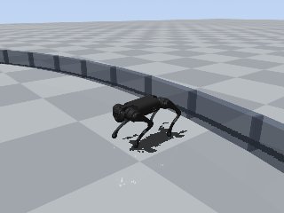

---

## Report 15: 2026-11-16, E11 too weak on leg posture → E12 (3–4× stronger) launched in parallel

| | Milestone 3 | E11 seeds (55–57M) | Goal |
|---|---|---|---|
| fore-aft foot offset | 11.3 cm | 8.2 / 10.2 / 10.1 cm | ≤ 8 |
| sideways foot offset | 5.0 cm | 5.2 / 4.4 / 4.5 cm | ≤ 5 |
| step-height spread | 87 % | 78 / 76 / 66 % | ≤ 20 % |
| step heights FR/FL/RR/RL | 15.5/10.0/9.3/6.5 | e.g. 15.4/8.1/9.0/7.8 cm | equal |
| walls / crab | 100 % / 0.1° | 100 / 83 / 67 % · 0.2–0.7° | ≥ 80 % / ≤ 10° |

- **Small improvement only.** The front-right leg still lifts about 14–15 cm while the others
  lift 7–9 cm. It is probably the outside leg on the counter-clockwise ring.
- **Why so slow:** the new terms are small next to the rest of the reward. A front leg at 15 cm
  instead of 8 costs only about 0.5 of about 8 reward per second.
- **Change: E12** (Amarel job 63984516, milestone 3 at 51M → 66M, in parallel with E11):
  - `foot_placement` −10 → −40
  - `hip_abduction` −2 → −6
  - `swing_shape` 1 → 3

  E11 keeps running untouched. The two runs together show the effect of the weight.

Media: `docs/media/review_55M_20261116_2343/`.

---

## Report 14: 2026-11-16, legs slanted and steps uneven → E11 launched; stage 2 prepared

### What the group noticed
Milestone 3 still walks "funny": the legs operate on a slant rather than perpendicular to the
ground and torso, and the cadence looks non-uniform.

### Measured on milestone 3 (front view below)

| Leg | Foot vs hip, sideways | Foot vs hip, fore-aft | Hip splay | Step height |
|---|---|---|---|---|
| front-right | 7.7 cm out | 4.9 cm behind | −5° | **15.5 cm** |
| front-left | 4.6 cm out | 8.5 cm behind | +3° | 10.0 cm |
| rear-right | **12.1 cm out** | **18.4 cm behind** | −3° | 9.3 cm |
| rear-left | **17.3 cm out** | **13.2 cm behind** | **+18°** | **6.5 cm** |

- **Slant:** the rear feet are planted wide and trail behind the hips. Against the new goals:
  fore-aft offset 11.3 cm ❌ (≤ 8), sideways splay 5.0 cm (borderline).
- **"Uneven cadence" is uneven legs, not timing.** Every leg steps exactly every 0.50 s (locked
  to the trot clock), but step heights range 6.5–15.5 cm (spread 87 % ❌, goal ≤ 20 %), so it
  looks like a slight limp.
- **Why:** nothing rewarded where the feet land, and `foot_clearance` only asks for *at least*
  8 cm of lift, so any mix of heights scored the same.

Front view of milestone 3 (legs angled outward, uneven lift):

### Change: E11 (Amarel job 63984256, 3 seeds, milestone 3 at 51M → 66M, no restart)
- `foot_placement` −10: stance feet back under the hips, where they sit in the standing pose.
- `hip_abduction` −2: no hip splay.
- `swing_shape` 1.0: every swinging foot follows the same smooth 8 cm lift curve, timed by the
  trot clock, so all four legs step alike.
- All E10 rewards and wall practice are kept.

### Stage 2 (obstacle course) prepared, starting after E11
- Group instruction: the **healthy** robot starts at the beginning of the course and learns to
  reach the end checkpoint.
- **Baseline:** the ring policy placed at the course start, even at difficulty 0, does not move
  (0.1 m) and falls in 3 of 3 runs. Walls on both sides of the lane look like "turn" situations
  from the ring.
  
- Fixes before training:
  - **Episodes 30 → 60 s.** 23.5 m at 0.6 m/s takes about 40 s, so the old episodes could never
    reach the goal.
  - **New course test** in the evaluator: run from the start; distance, sections cleared,
    goal reached, falls, time and full-run video.
- `amarel/course_ppo.slurm`:
  - continues from the best E11 policy
  - curriculum from difficulty 0 (+0.1 whenever the mean distance per episode exceeds 5 m)
  - spawns at random section starts so every obstacle type is practised
  - natural-gait rewards kept; `swing_shape` halved so it can lift higher for hurdles and steps

---

## Report 13: 2026-11-16, E10 late check: 2 seeds still perfect; seed 0's final eroded

| Run | Walls | Crab | Shin contact | Speed | Track error |
|---|---|---|---|---|---|
| E10 seed 0 **final** (59M) | ✅ 100 % | ✅ 1.4° | ❌ **18.6 %** | 0.48 m/s | 0.37 m |
| E10 seed 1 (58M) | ✅ 100 % | ✅ 0.6° | ✅ | ✅ 0.60 | ✅ 0.05 m |
| E10 seed 2 (56M) | ✅ 100 % | ✅ 0.1° | ✅ | ✅ 0.60 | ✅ 0.11 m |

- **Seeds 1 and 2 hold every goal** to the end of E10, a third consecutive pass.
- **Seed 0's last checkpoints eroded:** shins brushing the ground on 18.6 % of steps, and slower.
  This is the same late-training drift E7 seed 2 showed. It confirms the practice of picking
  policies **by evaluation (milestones)**, not by the last checkpoint. Milestone 3 (seed 1 at 51M)
  is unaffected.

Video of seed 1 at 58M (still perfect): 

---

## Report 12: 2026-11-16, ✅ STAGE 1 COMPLETE: stable, natural trot with wall handling

**Stability confirmed.** At the second consecutive review (50–52M), every E10 seed still passes
all 9 goals.

| Run | Walls (44–46M → 50–52M) | Crab | Track error | Speed |
|---|---|---|---|---|
| E10 seed 0 (52M) | 100 → 100 % | 1.4° | 0.09 m | 0.60 m/s |
| **E10 seed 1 (51M)** | 100 → **100 %** | **0.1°** | 0.14 m | 0.59 m/s |
| E10 seed 2 (50M) | 100 → 83 % | 0.1° | 0.12 m | 0.59 m/s |

### Final stage 1 policy: milestone 3, [`progress/milestones/e10_seed1_51M_stage1_final/`](progress/milestones/e10_seed1_51M_stage1_final)
E10 seed 1 at 51M steps:

| Goal | Result |
|---|---|
| pace (target 0.6 m/s) | ✅ 0.59 m/s |
| trot match | ✅ 0.985 |
| feet on the ground | ✅ 1.96 |
| shin/knee/belly contact | ✅ 0.6 % |
| falls | ✅ 0 % |
| wall test | ✅ **100 %** (6/6) |
| crab (body vs. travel direction) | ✅ **0.1°** |
| roll / pitch | ✅ 0.3° / 2.3° |
| distance from the yellow line | 0.14 m |
| foot lift | 8.2 cm |

| Walking | Facing the wall: turns, rejoins the line, trots on |
|---|---|
|  |  |

Videos for slides: [walk.mp4](progress/milestones/e10_seed1_51M_stage1_final/walk.mp4) · [wall.mp4](progress/milestones/e10_seed1_51M_stage1_final/wall.mp4).
Frames: 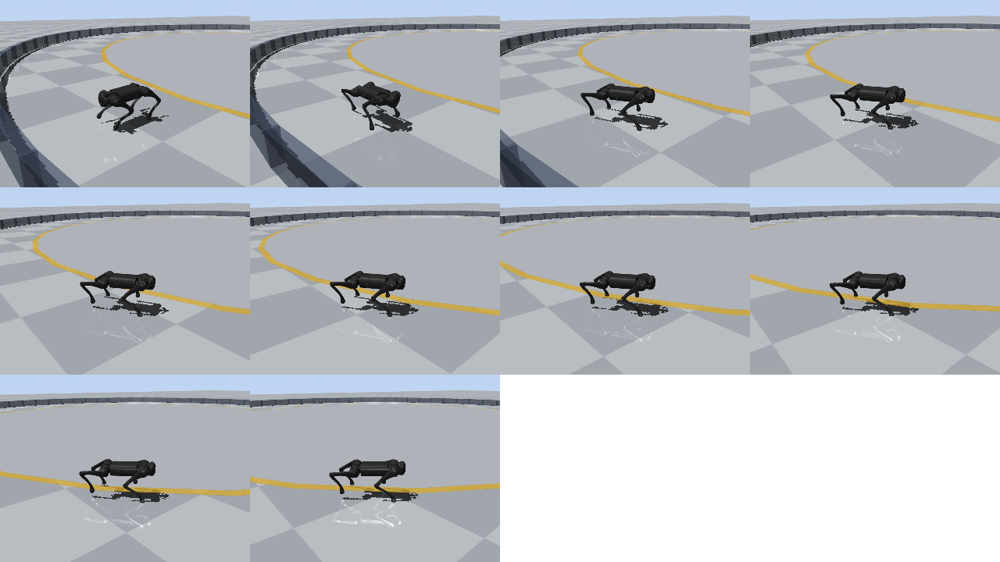

Watch it in MuJoCo:
`cd obstacle_course && mjpython play.py ../progress/milestones/e10_seed1_51M_stage1_final/policy.zip --arena ring --wall-test --episodes 0`

### How we got here (summary for the presentation)

| Step | Problem | Change | Result |
|---|---|---|---|
| E6 | — | course reward in the ring | ❌ sprinting/bounding at 3 m/s (reward hack) |
| E7 | uncapped progress, lap bonus | capped progress, trot ×2 | ✅ natural trot; walls drift 0–83 % |
| E8 | walls | signed turn reward, line following | ❌ dog freezes at walls; ✅ on the line |
| E9 | 30° crab (body slanted) | body alignment, potential-based turning, closer target | ✅ crab 0.1°; walls drift again |
| E10 | "wrong-way" trap at walls | practise the exact wall situation (30 % of episodes) | ✅ **all goals, stable** |

Milestones kept along the way: `e7_seed0_34M_all_six_goals` (first wall-capable, but crabbing),
`e9_seed2_39M_all_nine_goals` (first natural posture), `e10_seed1_51M_stage1_final`.

### Next
- E10 finishes at 59M on its own (final review then).
- **Stage 2: obstacle course.** Continue from milestone 3 with the difficulty curriculum. It still
  needs a decision on when to start.
- Phase 1 baseline: injured-leg evaluation of the final healthy policy.

---

## Report 11: 2026-11-16, ✅ E10: every seed passes every goal, walls 100 % (first review; stability to confirm)

E10 at 44–46M steps (5–7M into the continuation from milestone 2):

| Run | Pace | Trot | Feet | Shin | Falls | Walls | Crab | Roll | Pitch | Track error |
|---|---|---|---|---|---|---|---|---|---|---|
| E10 seed 0 | ✅ 0.49 | ✅ 0.90 | ✅ 2.30 | ✅ 0.3 % | ✅ 0 % | ✅ **100 %** | ✅ 1.6° | ✅ 1.4° | ✅ 1.4° | 0.39 m |
| E10 seed 1 | ✅ 0.63 | ✅ 0.98 | ✅ 1.96 | ✅ 0.5 % | ✅ 0 % | ✅ **100 %** | ✅ 1.0° | ✅ 0.2° | ✅ 2.6° | 0.10 m |
| E10 seed 2 | ✅ 0.62 | ✅ 0.97 | ✅ 1.99 | ✅ 0.6 % | ✅ 0 % | ✅ **100 %** | ✅ 1.2° | ✅ 0.1° | ✅ 2.9° | 0.06 m |

**All 3 seeds pass all 9 goals, with walls at 100 %.** The wall-test-like spawns removed the
"wrong-way" trap. Every wall trial turns away and walks on, with no freezing.

For comparison, the E9 finals (54M): walls 67 % on all seeds, crab 0.1–0.7°, no falls. E9 is
superseded by E10.

| E10 walking | E10 facing the wall head-on |
|---|---|
|  |  |

Videos: [walk.mp4](docs/media/review_44M_20261116_2244/ring_e10_seed0/walk.mp4) · [wall.mp4](docs/media/review_44M_20261116_2244/ring_e10_seed0/wall.mp4)

**Still to confirm:** stability. E7 and E9 also hit 100 % once, then drifted. The success rule is
≥ 80 % on every seed at **consecutive** reviews, so the next review (about 50M) decides. If it
holds, stage 1 is done and the best E10 checkpoint becomes milestone 3.

Minor: E10 seed 0 walks a bit slow (0.49 m/s, within the ±0.15 tolerance).

---

## Report 10: 2026-11-16, E9 walls regress on 2 seeds → E10 launched (practise the exact wall situation)

| Run | Walls (39M → 43M → now) | Falls | Crab | Track error |
|---|---|---|---|---|
| E9 seed 0 (46M) | 100 → 67 → ✅ **100 %** | ❌ **20 %** (1 of 5 walking episodes) | ✅ 0.5° | 0.39 m |
| E9 seed 1 (50M) | 83 → 100 → ❌ **17 %** | ✅ 0 % | ✅ 0.5° | 0.13 m |
| E9 seed 2 (50M) | 100 → 0 → ❌ **0 %** | ✅ 0 % | ✅ 0.7° | 0.16 m |

**Still working:** the posture fix holds on every seed (crab ≤ 0.7°).

**Poor progress on walls → decision rule triggered** (2 seeds regressed).

**Diagnosis: the "wrong-way" trap.** At the wall the route is 90° to the dog's *left*. If a
policy turns *right* instead, it ends up facing backwards along the route. From there, turning
either way scores the same, and walking backwards along the route earns nothing, so it stands
still (seed 2's frames). Which way each seed turns flips between checkpoints because training
rarely recreates that exact moment: most turn-practice spawns are *not* facing the wall.

**Change: E10** (Amarel job 63983457, 3 seeds, from milestone 2 at 39M → 59M). One change:
`--wall-spawn 0.5`, so about 30 % of all training episodes start exactly like the wall test
(0.8–1.2 m from the wall, facing it within ±60°). Verified over 400 spawns: 33 %. All E9 rewards
are unchanged.

Also watching: seed 0's 20 % fall rate (new; the first falls since E6).

Media (seed 0, 46M, walls 100 %): [wall.mp4](docs/media/review_46M_20261116_2226/ring_e9_seed0/wall.mp4)

**Next:** review E10 every 5M. Success = walls ≥ 80 % on all seeds **at consecutive reviews**
(stability), plus all posture and walking goals. E9 finishes at 54M and is then closed out.

---

## Report 9: 2026-11-16, E9 at 41–44M: posture fix holds; wall skill drifts between checkpoints again

| Run | Walls (39M → now) | Crab | Pitch | Track error | Pace |
|---|---|---|---|---|---|
| E9 seed 0 (41M) | 100 % → **67 %** | ✅ 0.3° | ✅ 2.8° | 0.50 m | ✅ 0.53 m/s |
| E9 seed 1 (43M) | 83 % → ✅ **100 %** | ✅ 0.3° | ✅ 3.3° | ✅ 0.20 m | ✅ 0.60 m/s |
| E9 seed 2 (43M) | 100 % → ❌ **0 %** | ✅ 0.2° | ✅ 3.0° | ✅ 0.09 m | ✅ 0.61 m/s |

**What's working:** the anti-crab fix is stable. Crab is 0.2–0.3° on every seed, the body is
level, and the trot is clean.

**What's not:** wall turning drifts between checkpoints, just as in E7. Seed 2 now turns about
90° away from the wall and then **stands still** facing along the ring (it fell in 1 of 6
trials). Seed 0 fails at −30° and −60° (one turn direction again).
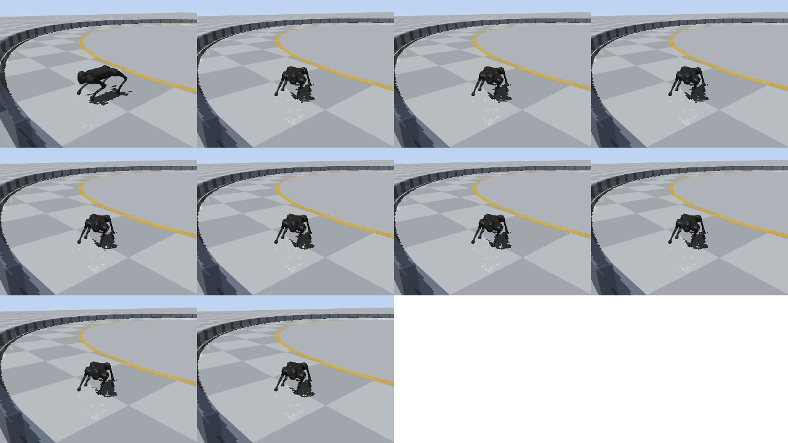

Best this review: seed 1 (walls 100 %, crab 0.3°, track 0.20 m). Video:
[wall.mp4](docs/media/review_41M_20261116_2215/ring_e9_seed1/wall.mp4), 

**Decision:** no change yet. Only one seed regressed badly, seed 1 improved, and milestone 2
(E9 seed 2 at 39M, walls 100 %) is preserved from before the dip. E9 finishes at 54M.

**If the drift continues to the end of E9**, the next experiment (E10) targets wall
*consistency*:
- wall-test-like spawns (1 m from the wall, facing it) as a fixed share of training episodes
- a small "keep moving" term, so that turning then standing still is not a resting point

Separately, policies can be picked by evaluation rather than by last checkpoint. That is
already done via milestones.

---

## Report 8: 2026-11-16, ✅ E9 passes every goal: natural, straight, level trot that turns away from walls

### Status at a glance (E9, 4–5M steps into the continuation)

| Run | Pace | Trot | Feet | Shin | Falls | Walls | **Crab** | Roll | Pitch | Track error |
|---|---|---|---|---|---|---|---|---|---|---|
| E9 seed 0 (38M) | ✅ 0.63 | ✅ 0.98 | ✅ 1.93 | ✅ 0.3 % | ✅ 0 % | ✅ **100 %** | ✅ **0.2°** | ✅ 0.2° | ✅ 3.1° | 0.50 m |
| E9 seed 1 (39M) | ✅ 0.62 | ✅ 0.97 | ✅ 1.99 | ✅ 0.7 % | ✅ 0 % | ✅ **83 %** | ✅ **0.5°** | ✅ 0.4° | ✅ 3.3° | 0.28 m |
| E9 seed 2 (39M) | ✅ 0.63 | ✅ 0.98 | ✅ 1.96 | ✅ 0.5 % | ✅ 0 % | ✅ **100 %** | ✅ **0.1°** | ✅ 0.2° | ✅ 3.2° | 0.38 m |

**All 3 seeds pass all 9 goals.** Before E9, the best policy crabbed 31° and pitched 5.4°.

### Milestone 2 saved: [`progress/milestones/e9_seed2_39M_all_nine_goals/`](progress/milestones/e9_seed2_39M_all_nine_goals)
E9 seed 2 at 39M: walls 100 %, crab 0.1°, track error 0.38 m. Policy, metrics and videos.

| Walking: body points where it goes | Facing the wall: turns, returns to the line, carries on |
|---|---|
| 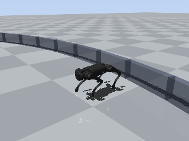 | 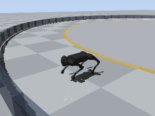 |

Videos (seed 0): [walk.mp4](docs/media/review_38M_20261116_2207/ring_e9_seed0/walk.mp4) · [wall.mp4](docs/media/review_38M_20261116_2207/ring_e9_seed0/wall.mp4).
Frames, wall test: 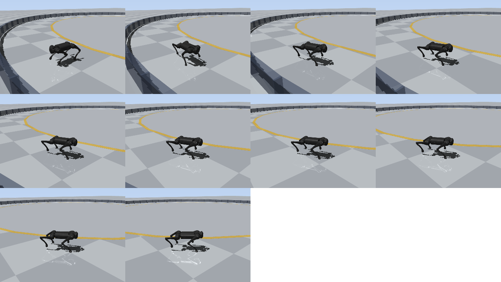

**Before vs. after (same camera, same test):**

| Milestone 1 (E7, crab 31°): body angled toward the ring centre | Milestone 2 (E9, crab 0.1°) |
|---|---|
|  |  |

### What made the difference
1. **`body_alignment` + `lateral_velocity`** (anti-crab): crab 31° → 0.1–0.5° within about
   4M steps.
2. **`heading_progress`** (potential-based turning): walls held or improved (83 % → 83–100 %),
   with no freezing. It fixed E8's mistake: wobble nets zero, real turning pays.
3. **Ring look-ahead 0.6 → 0.25 rad**: removed the 17° inward pull of the steering target.
4. **`orientation` −30**: roll fell to 0.2–0.4°. Pitch is 3.1–3.3° (within ≤ 4°), so the nose is
   still slightly down; worth watching.
5. **Starting from the milestone, not E8**: kept the wall skill E8 had lost.

### E8 final (60M) for the record
Walls 17–50 %, crab 12–15° (it improved late even without an alignment reward), track error
0.07–0.10 m, walking perfect. Superseded by E9.

### Notes
- Track error is 0.28–0.50 m: good, but seed 0 is right at the 0.5 m limit. E9 trades a little
  line accuracy for the posture fix.
- Housekeeping: per-run evaluation videos are no longer committed under `progress/` (they
  duplicated `docs/media/`; about 30 MB per review). Milestone and best-seed videos are kept.

### Next
- E9 continues to 54M. The next reviews check that the gains hold (E7 showed skills can drift).
- **Stage 1 (training ring) is essentially complete.** Next is **stage 2: the obstacle course**,
  continuing from milestone 2 with the difficulty curriculum. That needs a decision on running
  it while E9 finishes, or after.

---

## Report 7: 2026-11-16, E8 backfired (dog freezes at walls); E9 launched from the milestone

### E8 at 50M steps

| Run | Pace | Trot | Shin | Falls | Walls | Track error | Crab | Roll | Pitch |
|---|---|---|---|---|---|---|---|---|---|
| E8 seed 0 (51M) | ✅ 0.60 | ✅ 1.00 | ✅ 0.1 % | ✅ 0 % | ❌ **0 %** | ✅ 0.11 m | ❌ 25° | ✅ 1.3° | ✅ 1.6° |
| E8 seed 1/2 (50M, identical runs) | ✅ 0.60 | ✅ 1.00 | ✅ 0.1 % | ✅ 0 % | ❌ **0 %** | ✅ 0.08 m | ❌ 27° | ✅ 1.6° | ✅ 1.7° |

Frames, facing the wall head-on: the dog **stands completely still** for the full 10 s.
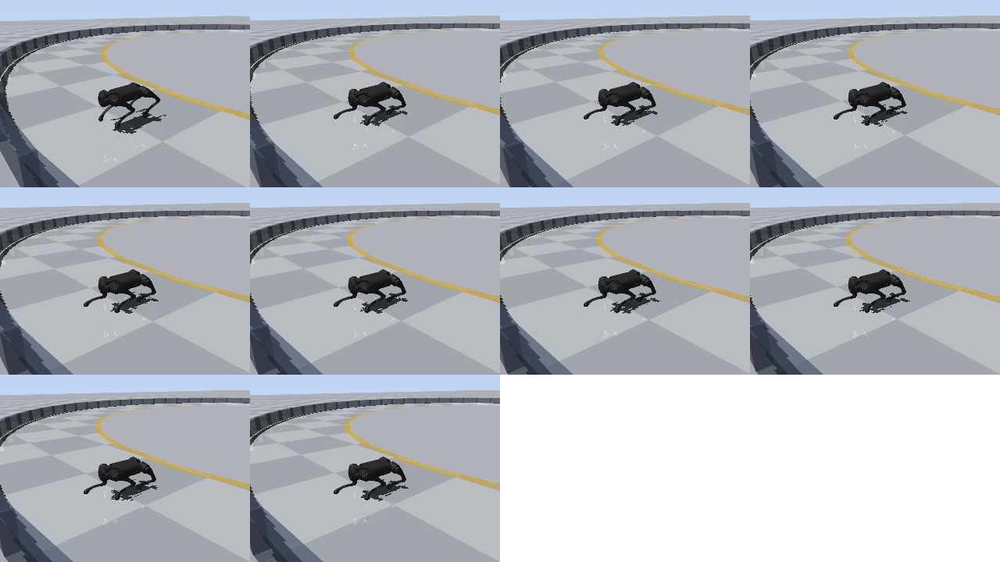

**What went wrong.** E8's `turn_to_route` reward was +1 for turning toward the route and −1 for
turning away. Trotting in place makes the body wobble slightly in yaw, and half of that wobble
counted as "turning away". So the cheapest behaviour at a wall became **freezing**. Wall pass
rate fell from 17–83 % (E7) to 0 % everywhere.

**What E8 got right**
- `track_following` works: 1.2 m → **0.08–0.11 m** from the yellow line.
- Lean and tilt are now within the goals: roll 1.3–1.6°, pitch 1.6–1.7°.
- The crab improved slightly (31° → 25–27°), but nothing in E8 targets it directly.

### Change: E9 launched now, in parallel (E8 left running to finish, no restart)
- **Start point:** the E7 milestone policy (34M, walls 83 %), *not* E8. It keeps the best wall
  skill and adds the line and posture rewards on top.
- **New turn reward `heading_progress`** (potential-based) replaces `turn_to_route`. It is
  (|heading error| before − after) / dt while more than 30° off the route. Turning toward the
  route pays, and wobbling back and forth nets exactly zero, so freezing gains nothing. Unit
  test: turning for 1 s earns +0.86, standing still +0.01.
- Kept from E8: `track_following` 1.0, turn-practice 40 %.
- Posture (from report 6): `body_alignment` 1.5, `lateral_velocity` −2, `orientation` −30,
  ring look-ahead 0.25 rad.
- Amarel job 63983152, 3 properly seeded runs (seed fix verified), 34M → 54M steps (~45 min).

### Next
- Review E9 at 40M, 45M and 50M. Success: walls ≥ 80 %, crab ≤ 10°, roll ≤ 3°, pitch ≤ 4°,
  track error ≤ 0.5 m, and every walking goal.
- E8 finishes at 60M. Its final policies get reviewed, then it is closed out in the log.

---

## Report 6: 2026-11-16, the dog walks "slanted": crabbing found and E9 prepared; E8 at 45M

### What the group noticed
Watching the milestone policy, the body looked constantly slanted, with an odd drift: not
natural enough for a professional demonstration.

### What it is: crabbing (measured)
The dog walks diagonally. Its body is turned about **30° away from the direction it moves**,
with 0.4 m/s of sideways speed, and its nose is pitched down about 5°.

| Policy | Crab angle | Sideways speed | Roll | Pitch |
|---|---|---|---|---|
| E7 seed 1 at 6M (early) | −30° | −0.34 m/s | −0.9° | 0.0° |
| milestone (E7 seed 0, 34M) | **−31°** | −0.40 m/s | −2.8° | +5.4° |
| E7 seed 0 final (40M) | **−31°** | −0.40 m/s | 2.6° | 5.9° |
| E7 seed 1 final (E8 start) | **−33°** | −0.42 m/s | −2.0° | +1.5° |

It has been there since the earliest walking policies; we just never measured it. Against the new
posture goals, the milestone fails crab (31° vs ≤ 10°) and pitch (5.4° vs ≤ 4°).

**Why:**
1. No reward term checks which way the body points. Speed is measured along the direction of
   travel, so walking diagonally earns full reward. The heading term (+0.5) loses only about
   0.07/s for a 30° crab.
2. A design flaw in the ring steering target: it sits 0.6 rad ahead on the circle, about 17°
   *inward* of the travel direction, and the heading reward asks the body to face it. That pulls
   the body to angle inward.
3. The tilt penalty is too weak for small angles (5° costs about 0.008/s).

### Fix: E9 (continuation after E8, no restart)
- `body_alignment` reward 1.5: highest when the body points where it moves (10° tolerance).
- `lateral_velocity` penalty −2.0: no sideways or diagonal walking.
- `orientation` penalty −1 → −30: 5° of lean now costs about 0.23/s.
- Ring steering target 0.6 → 0.25 rad ahead: only about 7° inward.
- Keeps E8's turn reward, line following and 40 % wall practice.

A 30° crab now loses about 1.8 reward per second (of about 6.7 for a good trot).

### E8 at 45M steps (5M into the continuation)

| Run | Pace | Trot | Shin contact | Falls | Walls | Track error |
|---|---|---|---|---|---|---|
| E8 seed 0 (46M) | ✅ 0.62 | ✅ 1.00 | ✅ 0.1 % | ✅ 0 % | ❌ 0 % | ✅ **0.11 m** |
| E8 seed 1 (45M) | ✅ 0.61 | ✅ 1.00 | ✅ 0.1 % | ✅ 0 % | ❌ 33 % | ✅ **0.27 m** |
| E8 seed 2 (45M) | identical to seed 1 (see bug below) | | | | | |

(The E8 evaluations ran just before the posture metrics were added, so crab, roll and pitch will
appear from the next review.)

- **Line-following works:** distance from the yellow line fell from 1.2 m to 0.1–0.3 m within 5M
  steps.
- **Walls:** no improvement yet (0–33 %). Too early to judge E8's turn reward.
- **Bug found: E8 seeds 1 and 2 are the same run** (identical training stats). Continuations
  restored the saved random seed and ignored `--seed`. Fixed for E9 (`set_random_seed` after
  loading; verified that two seeds now train to different weights). E8 is left running
  (no-restart rule) as effectively 2 runs.

Media: E7 seed 0 final at 40M: [walk.gif](docs/media/review_39M_20261116_2143/ring_seed0/walk.gif) ·
[wall.gif](docs/media/review_39M_20261116_2143/ring_seed0/wall.gif) · [walk.mp4](docs/media/review_39M_20261116_2143/ring_seed0/walk.mp4). The crab is visible:
the body points to the inside of the ring while the dog travels along it.

### Next
- E8 finishes at 60M (about 30 min). Then **E9** continues from the best E8 policy:
  `amarel/ring_e9.slurm`, 3 properly-seeded runs, to 80M.
- E9 success: all gait goals **and** crab ≤ 10°, roll ≤ 3°, pitch ≤ 4°, walls ≥ 80 %, track
  error ≤ 0.5 m.

---

## Report 5: 2026-11-16, E7 finished (seeds 1 and 2) + first all-goals policy + E8 launched

### Milestone: first policy that meets every Phase 1 ring goal 🎉
**E7 seed 0 at 34M steps** passes all six goals. It is saved as
[`progress/milestones/e7_seed0_34M_all_six_goals/`](progress/milestones/e7_seed0_34M_all_six_goals)
(policy + normalisation stats + metrics + videos).

| Pace | Trot | Feet down | Shin contact | Falls | Walls | Track error |
|---|---|---|---|---|---|---|
| ✅ 0.59 m/s | ✅ 0.99 | ✅ 2.0 | ✅ 0.6 % | ✅ 0 % | ✅ **83 %** (5/6) | 1.21 m (not a goal) |

Wall trials: head-on twice, +30°, −30° and +60° all passed. It turned away within about 1 s and
walked 4.1–6.1 m along the ring, never touching the wall (closest 0.64 m). It turns **both ways**
now. It failed only −60° (stuck, 0.35 m).

| Walking | Facing the wall head-on: turns away and walks off |
|---|---|
|  |  |

Videos: [walk.mp4](docs/media/review_34M_20261116_2128/ring_seed0/walk.mp4), [wall.mp4](docs/media/review_34M_20261116_2128/ring_seed0/wall.mp4).
Frames: 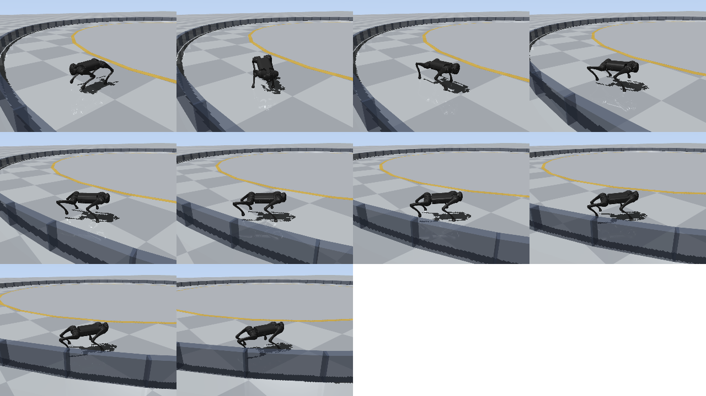

Caveat: after turning, it walks alongside the outer wall instead of returning to the yellow
line (track error 1.2 m).

### E7 final results (40M steps)

| Run | Pace | Trot | Shin contact | Falls | Walls | Track error | Note |
|---|---|---|---|---|---|---|---|
| seed 0 | (still training, 34M → 40M) | | | | | | milestone above |
| seed 1 final | ✅ 0.59 | ✅ 1.00 | ✅ 0.1 % | ✅ 0 % | ❌ 17 % | 1.17 m | best walker, stuck at walls |
| seed 2 final | ✅ 0.48 | ✅ 0.92 | ❌ 10 % | ✅ 0 % | ❌ 17 % | 0.45 m | walking slipped late in training |

Media: `docs/media/e7_final/seed1`, `docs/media/e7_final/seed2`.

**What this tells us**
- The same reward gives very different wall behaviour per seed and per checkpoint. The skill
  appears and disappears (seed 0: 33 → 17 → 17 → 83 %; seed 1: 17 → 67 → 0 → 17 %).
  "Stop and wait at the wall" and "turn and go" earn similar reward in E7, so training drifts
  between them. A direct turning reward should make "turn and go" clearly better: that is E8.
- Long training can also erode walking (seed 2: shin contact 0.5 % → 10 % from 27M to 40M).
  Keeping milestone snapshots matters.

### What changed
- **E8 launched** (Amarel job 63982746, 3 seeds, 40M → 60M steps). It continues from **E7
  seed 1 final**, the best walker, which was stuck at walls and off the line:
  - `turn_to_route` reward 1.0
  - `track_following` reward 1.0
  - wall/turn-practice spawns 25 % → 40 %
  - walking rewards unchanged
- Fixed `--init-from` continuations keeping the 40M step count (it would have restarted the
  counter).

### Next
- Review E8 at each 5M milestone. Success: walls ≥ 80 % in both turn directions, track error
  ≤ 0.5 m, and the walking goals still passing.
- E7 seed 0 finishes 40M untouched.
- Once a policy meets all goals including track error, move to **stage 2: the obstacle
  course**, continuing from it.

---

## Report 4: 2026-11-16, ring v2 (E7) at 21–27M steps

**Status at a glance** (new column: track error = average distance from the yellow line)

| Run | Steps (eval ckpt) | Pace | Trot | Feet down | Shin contact | Falls | Walls | Track error | Overall |
|---|---|---|---|---|---|---|---|---|---|
| seed 0 | 20.9M (21M) | ✅ 0.59 m/s | ✅ 1.00 | ✅ 2.00 | ✅ 0.3 % | ✅ 0 % | ❌ 17 % | 1.14 m | walks perfectly, stuck at walls, off the line |
| seed 1 | 27.5M (27M) | ✅ 0.61 m/s | ✅ 0.99 | ✅ 2.00 | ✅ 0.2 % | ✅ 0 % | ❌ 0 % | 1.00 m | walks perfectly, stuck at walls, off the line |
| seed 2 | 27.7M (27M) | ✅ 0.60 m/s | ✅ 0.99 | ✅ 2.02 | ✅ 0.5 % | ✅ 0 % | ❌ 17 % | 0.23 m | walks perfectly on the line, stuck at walls |

**Media** (seed 0, 21M; video: [walk.mp4](docs/media/review_20M_20261116_2054/ring_seed0/walk.mp4), [wall.mp4](docs/media/review_20M_20261116_2054/ring_seed0/wall.mp4))

| Walking | Facing the wall head-on: stops about 1 m short and trots in place |
|---|---|
|  |  |

**What changed since report 3**
- No training changes (no restarts).
- E8 extended (still opt-in, off for running jobs): added a `track_following` reward after the
  group noticed later policies walking off the yellow line. Measured: seeds 0 and 1 walk
  1.0–1.4 m *outside* the line, seed 2 stays within 0.2–0.4 m.

**What's working**
- **Walking is perfect and stable on all 3 seeds:** trot match 0.99–1.00, exactly 2 feet down,
  0.59–0.61 m/s, shin contact ≤ 0.5 %, no falls.
- **No wall collisions** in the head-on, ±30° and −60° trials. The dog always stops about 1 m
  short.

**What's not working (poor progress, so tweaking)**
- **Wall turning is getting worse with training:** 33/17/67 % (report 2) → 17/67/17 %
  (report 3) → **17/0/17 %** now. The only pass left is the +60° glancing angle.
  - The policies have converged on "stop at the wall and trot in place". In E7 that is a safe
    local optimum: it keeps the alive, trot and heading rewards and avoids the wall penalties.
    Turning around has no direct payoff.
  - Seen in the viewer for seed 0 (10M): at +60° it scrapes along the wall (6–9 touches) instead
    of turning away.
- **Track drift** on seeds 0 and 1 (about 1 m outside the line). Nothing rewards being on the line.

**Next: E8 (automatic, as soon as seeds 1 and 2 finish 40M, about 25 min)**
- Continue from the best E7 final policy with no restart:
  - `turn_to_route` reward 1.0
  - `track_following` reward 1.0
  - turn-practice spawns 40 %
- Success: wall pass rate ≥ 80 % and track error ≤ 0.5 m, with all walking goals still passing.

---

## Report 3: 2026-11-16, ring v2 (E7) at 16–21M steps

**Status at a glance**

| Run | Steps (eval ckpt) | Pace | Trot | Feet down | Shin contact | Falls | Walls | Overall |
|---|---|---|---|---|---|---|---|---|
| seed 0 | 16.0M (16M) | ✅ 0.59 m/s | ✅ 0.99 | ✅ 1.98 | ✅ 0.2 % | ✅ 0 % | ❌ 17 % | 5 of 6 goals |
| seed 1 | 21.1M (21M) | ✅ 0.60 m/s | ✅ 1.00 | ✅ 2.00 | ✅ 0.4 % | ✅ 0 % | 🟡 67 % | 5 of 6 goals, best at walls |
| seed 2 | 21.2M (21M) | ✅ 0.58 m/s | ✅ 0.99 | ✅ 2.02 | ✅ 0.4 % | ✅ 0 % | ❌ 17 % | 5 of 6 goals |

**Media** (best seed: seed 1, 21M steps; video: [walk.mp4](docs/media/review_15M_20261116_2042/ring_seed1/walk.mp4),
[wall.mp4](docs/media/review_15M_20261116_2042/ring_seed1/wall.mp4))

| Walking (trot match 1.00) | Facing the wall head-on: turns away and walks off |
|---|---|
|  |  |

- seed 1 at the wall (turns): 
- seed 2 at the wall (now stuck; it was turning at 14M): 

**What changed since report 2**
- No training changes (no restarts).
- Tooling:
  - `play.py --wall-test` replays the wall test in the MuJoCo viewer.
  - Reviews now save media automatically.
- **Prepared, not yet used:** E8. An opt-in `turn_to_route` reward plus a
  `--turn-practice` spawn share (see EXPERIMENT_LOG). It is off by default, so the running jobs are unaffected.

**What's working**
- **Walking is essentially perfect on all 3 seeds:**
  - trot match 0.99–1.00, exactly about 2 feet down (a clean diagonal pair)
  - pace within 0.02 m/s of target, shin contact < 0.5 %, no falls
- **Never touching walls.** In all 18 trials the dog stopped before the wall.

**What's not working**
- **Turning away from walls is unstable.** The pass rate swaps between seeds from one
  checkpoint to the next:

  | Seed | 10–14M | 16–21M |
  |---|---|---|
  | 0 | 33 % | 17 % |
  | 1 | 17 % | 67 % |
  | 2 | 67 % | 17 % |

  Each policy learns to turn one way, then drifts. More training alone is not settling it: turning
  is paid only indirectly (heading +0.5), and only about 25 % of episodes practise it.
- Seeds 0 and 1 drift about 1 m off the track line while still walking well (track error
  1.1–1.2 m vs 0.3 m for seed 2). This is minor and not a goal yet.

**Next**
- E7 finishes at 40M steps (seeds 1 and 2 in about 25 min; seed 0 is on a slower node).
- Then, per the decision rules (wall pass rate < 50 % for most seeds), run **E8 as a
  continuation** from the best E7 final policy:
  - `turn_to_route` = 1.0 (reward for turning toward the route when facing more than 45° away)
  - turn-practice spawns 25 % → 40 %
  - walking rewards unchanged

---

## Report 2: 2026-11-16, ring v2 (E7) at 10–14M steps

**Status at a glance**

| Run | Steps (eval ckpt) | Pace | Trot | Feet down | Shin contact | Falls | Walls | Overall |
|---|---|---|---|---|---|---|---|---|
| seed 0 | 10.7M (10M) | ✅ 0.60 m/s | ✅ 0.97 | ✅ 1.88 | ✅ 0.3 % | ✅ 0 % | ❌ 33 % | 5 of 6 goals |
| seed 1 | 14.1M (14M) | ✅ 0.62 m/s | ✅ 0.97 | ✅ 1.88 | ✅ 0.3 % | ✅ 0 % | ❌ 17 % | 5 of 6 goals |
| seed 2 | 14.3M (14M) | ✅ 0.60 m/s | ✅ 0.98 | ✅ 1.92 | ✅ 0.2 % | ✅ 0 % | 🟡 67 % | 5 of 6 goals, walls close |

**Media** (best seed: seed 2, 14M steps; full-quality video:
[walk.mp4](docs/media/report2/seed2/walk.mp4), [wall.mp4](docs/media/report2/seed2/wall.mp4))

| Walking: natural trot at 0.6 m/s | Facing the wall head-on: stops, turns, walks away |
|---|---|
|  |  |

Frame sequences (left to right, top to bottom):
- seed 2 walking: 
- seed 2 at the wall (turns around): 
- seed 0 at the wall (stops but stays stuck): 

**For comparison, the failed sprinting policy (E6, ring v1 at 7M steps):** it bounds at
2.7 m/s with about 1.3 feet down and shins scraping. Video:
[walk.mp4](docs/media/e6_ring_v1_sprinting/walk.mp4)

**What changed since report 1**
- No reward or setting changes. Training simply continued (no restarts, per the group decision).
- Tooling:
  - `play.py` now plays policies at real time in a loop, for watching the gait.
  - Checkpoint reviews now trigger when the slowest run passes a milestone.
- Hardware decided: keep 32-core CPU nodes. 64 cores gave the same speed (EXPERIMENT_LOG H1).

**What's working**
- **Natural walking is solved for all 3 seeds:**
  - pace within 0.02 m/s of the 0.6 m/s target
  - trot match 0.97–0.98, about 1.9 feet down (a clean diagonal pair)
  - shin contact down from 11–12 % to 0.2–0.3 %
  - 9–11 cm foot lift and no falls
- **Walls: "stop before the wall" is solved.** Across all 18 wall trials the dog never touched
  the wall once. It always stops about 1 m short.
- **Walls: "turn and keep going" is emerging on its own.** Seed 2 turns around from a head-on
  start and trots away along the track in 4 of 6 trials (`progress/ppo_ring_seed2/eval/frames_wall.png`):
  it faces the wall, turns in place for about 2 s, then walks off.

**What's not working yet**
- **Turning is still unreliable.** Seeds 0 and 1 often stand and trot in place when facing the
  wall (33 % and 17 %). Each seed tends to turn only one way: seed 1 passed only the −60° trial,
  and seed 0 only +30° and +60°. When the "easy" turn direction is the wrong one, it gets stuck.

**Next**
- Training continues to 40M steps (about 25 more minutes). Walls are improving without changes,
  so no tweak yet.
- At 40M, by the decision rules: if wall pass rate is < 50 % for the best seed, continue from
  that policy with the "turn toward the route" reward (E8).
- If the walls pass (seed 2 is close), next comes stage 2: the obstacle course, continuing from
  the best ring policy.

---

## Report 1: 2026-11-16, ring v2 (E7) at about 5M steps

**Status at a glance**

| Run | Steps | Pace | Trot | Feet down | Shin contact | Falls | Walls | Overall |
|---|---|---|---|---|---|---|---|---|
| seed 0 | 3.7M (eval of the 3M ckpt) | ❌ 0.12 m/s | ✅ 0.79 | ❌ 2.75 | ✅ 2 % | ✅ 0 % | ❌ 0 % | still learning to move |
| seed 1 | 5.3M | ✅ 0.55 m/s | ✅ 0.84 | ✅ 2.28 | ❌ 12 % | ✅ 0 % | ❌ 0 % | 4 of 6 goals |
| seed 2 | 5.2M | ✅ 0.51 m/s | ✅ 0.87 | ✅ 2.09 | ❌ 11 % | ✅ 0 % | ❌ 17 % | 4 of 6 goals |

**Media** (frames at 5M steps; no videos were recorded yet at this stage)

| Seed 2 walking | Seed 2 facing a wall: stops, then trots in place |
|---|---|
|  |  |

**What changed since the last run**
- Fixed the sprinting reward hack from ring v1 (E6):
  - progress is capped at the target speed
  - the lap bonus is removed
  - speed tracking is stronger, trot ×2, shin-contact penalty ×2
- Added the goal-based checkpoint evaluation (`evaluate_policy.py`) and the review tool
  (`tools/review_checkpoint.py`).

**What's working**
- **The gait fix worked.** v1 bounded at about 3 m/s with a trot match of 0.52. v2 seeds 1 and 2
  now trot at the target pace (0.51–0.55 m/s) with a trot match of 0.84–0.87, about 2 feet down,
  9–11 cm foot lift and no falls, after only about 5M steps (about 10 minutes).
- The frames show a level body with diagonal legs alternating.

**What's not working yet**
- **Walls (main gap).** Facing a wall from 1 m, the dog stops short without touching it, which
  is good, but then trots in place instead of turning. It only gets away when the wall is at a
  shallow angle (60°).
- **Shin contact 11–12 %.** Seeds 1 and 2 occasionally brush a calf on the ground.
- **Seed 0** is behind: it stands and trots in place (0.12 m/s). It may catch up; seeds vary.

**Next**
- Let E7 run to 40M steps (no restart), then apply the decision rules above (walls first).
- **Hardware:** benchmarked 32 vs 64 CPU cores: same speed (about 8,900 steps/s), because the
  network update is the bottleneck. Decision: keep 32-core CPU nodes (EXPERIMENT_LOG H1).
